# Capítulo IV: Product Implementation & Validation

## 4. Product Implementation & Validation

La implementación de InmoNode, desarrollado por NovaCorp, comprende la Landing Page, los servicios RESTful, la aplicación Android para agentes comerciales y la aplicación Flutter, para Android y Web, del comprador y del back-office. El trabajo se organiza por Sprints, relacionando las historias seleccionadas con evidencias de desarrollo, pruebas, documentación, despliegue y validación.

Los productos distribuyen las capacidades comerciales, documentales y financieras de los bounded contexts definidos en el diseño. La aplicación Android nativa concentra la operación en campo; la aplicación Flutter, el autoservicio del comprador y el back-office; y los servicios RESTful, la consolidación e integración de la información.

Para el feature de aprendizaje autónomo se selecciona ML Kit Text Recognition, asociado con US-47 y US-09. El equipo evaluará el reconocimiento local de vouchers y la interpretación de monto, fecha y código de operación, manteniendo la revisión humana de los datos extraídos.

### 4.1. Software Configuration Management

En esta sección se establecen las decisiones comunes sobre el entorno de desarrollo, la organización del código, las convenciones y el despliegue.

#### 4.1.1. Software Development Environment Configuration

El equipo utiliza Jira para gestionar el Product Backlog y Trello para el seguimiento del Sprint 1; la URL del tablero se registra en la sección 4.2.1.3. El desarrollo utiliza Spring Boot, HTML5/CSS3/JavaScript, Android Studio con Kotlin y Jetpack Compose, y Flutter con Dart. La [Tabla 4.1](#tabla-4-1) detalla cada herramienta, su propósito y su ruta de referencia o descarga.

<a id="tabla-4-1"></a>

**Tabla 4.1**

*Herramientas del entorno de desarrollo*

| Actividad | Herramienta | Propósito en el proyecto | Referencia o descarga |
|:---|:---|:---|:---|
| Project Management y Requirements Management | Jira | Gestionar el Product Backlog y su selección por Sprint. | [atlassian.com/software/jira](https://www.atlassian.com/software/jira) |
| Seguimiento del Sprint | Trello | Registrar tareas y su evolución en To Do, In Process, To Review y Done. | [trello.com](https://trello.com/) |
| Investigación UX | UXPressia | User Personas, Empathy Maps, User Journey Maps e Impact Mapping. | [uxpressia.com](https://uxpressia.com/) |
| Exploración del dominio | Miro | Big Picture EventStorming y EventStorming del dominio. | [miro.com](https://miro.com/) |
| Product UX/UI Design | Figma | Wireframes, mock-ups y prototipos. | [figma.com](https://www.figma.com/) |
| Flujos de interacción | Lucidchart u Overflow | Wireflows y User Flows. | [lucidchart.com](https://www.lucidchart.com/) · [overflow.io](https://overflow.io/) |
| Arquitectura de software | Structurizr DSL y PlantUML | Diagramas C4 de contexto, contenedores, componentes y despliegue. | [structurizr.com](https://structurizr.com/) · [plantuml.com](https://plantuml.com/) |
| UML y diseño de datos | PlantUML | Diagramas de clases del Domain Layer y diagramas de base de datos. | [plantuml.com](https://plantuml.com/) |
| Desarrollo de la Landing Page | HTML5, CSS3 y JavaScript | Sitio estático del modelo de negocio. | [developer.mozilla.org](https://developer.mozilla.org/) |
| Desarrollo de Web Services | Spring Boot (Java 21) | Servicios RESTful internos. | [spring.io/projects/spring-boot](https://spring.io/projects/spring-boot) |
| Desarrollo multiplataforma | Flutter 3.47 (Dart 3.13), http y get_it | Aplicación del comprador e inversionista y del back-office para Android y Web. | [flutter.dev](https://flutter.dev/) · [dart.dev](https://dart.dev/) |
| Lenguaje de diseño | Material Design 3 | Referencia visual de las aplicaciones Android y Flutter. | [m3.material.io](https://m3.material.io/) |
| Desarrollo Android | Android Studio, Kotlin y Jetpack Compose | Aplicación nativa e interfaces. | [developer.android.com/studio](https://developer.android.com/studio) · [kotlinlang.org](https://kotlinlang.org/) |
| Aprendizaje autónomo | ML Kit Text Recognition v2 | Reconocimiento local de texto de vouchers. | [developers.google.com/ml-kit](https://developers.google.com/ml-kit/vision/text-recognition/v2/android) |
| Especificación de pruebas | Gherkin | Escenarios de aceptación de las historias. | [cucumber.io/docs/gherkin](https://cucumber.io/docs/gherkin/reference/) |
| Software Testing | JUnit Jupiter, Mockito, Spring Boot Test, Testcontainers y flutter_test | Pruebas unitarias, de controladores y de integración con PostgreSQL; la suite con contenedores requiere Docker. En Flutter, pruebas unitarias y de widgets. | [docs.spring.io/spring-boot](https://docs.spring.io/spring-boot/reference/testing/index.html) |
| Documentación de servicios | OpenAPI / Swagger (springdoc-openapi) | Contratos de los endpoints RESTful. | [openapis.org](https://www.openapis.org/) · [swagger.io](https://swagger.io/) |
| Control de versiones | Git y GitHub | Historial, ramas y pull requests de todos los productos. | [git-scm.com](https://git-scm.com/) · [github.com](https://github.com/) |
| Software Deployment | GitHub Pages, Render, Supabase, CloudAMQP, Vercel, Firebase App Distribution y Docker | Publicación de la Landing Page, de los Web Services, de la versión web de la aplicación Flutter y de los APK. | [pages.github.com](https://pages.github.com/) · [render.com](https://render.com/) · [supabase.com](https://supabase.com/) · [vercel.com](https://vercel.com/) · [firebase.google.com/docs/app-distribution](https://firebase.google.com/docs/app-distribution) |
| Software Documentation | GitHub y Markdown | Elaboración y versionamiento del informe. | [github.com](https://github.com/) · [markdownguide.org](https://www.markdownguide.org/) |

#### 4.1.2. Source Code Management

Git registra las modificaciones y GitHub aloja los repositorios de la organización del equipo. El repositorio de los Web Services conserva el código y las pruebas unitarias y de integración. La [Tabla 4.2](#tabla-4-2) identifica el repositorio de cada producto.

<a id="tabla-4-2"></a>

**Tabla 4.2**

*Repositorios de los productos de la solución*

| Producto | Repositorio | Contenido relevante |
|:---|:---|:---|
| Landing Page | [InmoNode-Landing-Page](https://github.com/1ACC0238-2620-13981-NovaCorp-InmoNode/InmoNode-Landing-Page) | HTML, CSS, JavaScript y recursos gráficos. |
| Web Services | [InmoNode-Backend](https://github.com/1ACC0238-2620-13981-NovaCorp-InmoNode/InmoNode-Backend) | Spring Boot, configuración, Dockerfile y pruebas. |
| Aplicación Android | [InmoNode-Mobile](https://github.com/1ACC0238-2620-13981-NovaCorp-InmoNode/InmoNode-Mobile) | Kotlin, Jetpack Compose, recursos y configuración de compilación. |
| Aplicación Flutter | [InmoNode-Flutter](https://github.com/1ACC0238-2620-13981-NovaCorp-InmoNode/InmoNode-Flutter) | Dart y Flutter para Android y Web; un feature por bounded context en `lib/features/`, inyección de dependencias y cliente HTTP de los Web Services. |

El equipo aplica GitFlow (Driessen, 2010). La [Tabla 4.3](#tabla-4-3) define las ramas, su origen, su integración y la convención de nombres.

<a id="tabla-4-3"></a>

**Tabla 4.3**

*Ramas de GitFlow y convenciones de nombre*

| Rama | Propósito | Origen | Integración | Convención de nombre |
|:---|:---|:---|:---|:---|
| main | Versiones publicadas | Inicialización | Recibe release y hotfix | `main` |
| develop | Integración del desarrollo | main | Recibe feature y correcciones | `develop` |
| feature | Una funcionalidad por rama | develop | develop | `feature/<story-id>-<short-description>` |
| release | Preparación de una versión | develop | main y develop | `release/<MAJOR.MINOR.PATCH>` |
| hotfix | Corrección de una versión publicada | main | main y develop | `hotfix/<MAJOR.MINOR.PATCH>` |

Si existe una release activa, el hotfix se incorpora también a ella y se conserva en develop al cerrarla. Por ejemplo, la Landing Page publicó las versiones 1.0.0, 1.1.0 y 1.2.0 mediante las ramas `release/1.0.0`, `release/1.1.0` y `release/1.2.0`.

Los mensajes de commit siguen Conventional Commits con la estructura `<type>[optional scope][!]: <description>`, por ejemplo `feat(prospects): add offline prospect registration` y `fix(reservations): reject unavailable lots`. Las versiones siguen Semantic Versioning con el formato `MAJOR.MINOR.PATCH`, que distingue cambios incompatibles, funcionalidades compatibles y correcciones compatibles.

#### 4.1.3. Source Code Style Guide & Conventions

La nomenclatura del código se mantiene en inglés. La [Tabla 4.4](#tabla-4-4) resume la guía de referencia y las convenciones adoptadas para cada lenguaje.

<a id="tabla-4-4"></a>

**Tabla 4.4**

*Guías de estilo y convenciones por lenguaje*

| Lenguaje | Guía de referencia | Convenciones principales |
|:---|:---|:---|
| Kotlin | Kotlin Coding Conventions / Android Kotlin Style Guide | Clases e interfaces en UpperCamelCase; funciones y variables en lowerCamelCase; constantes en UPPER\_SNAKE\_CASE; paquetes en minúsculas y archivos descriptivos. Las funciones Composable conservan su convención específica (UpperCamelCase). |
| Java | Google Java Style Guide | Clases e interfaces en UpperCamelCase; métodos y variables en lowerCamelCase; constantes en UPPER\_SNAKE\_CASE; paquetes en minúsculas y archivo con el nombre de la clase. |
| Dart | Effective Dart | Clases, enums y typedefs en UpperCamelCase; variables, funciones y constantes en lowerCamelCase; archivos, carpetas y paquetes en lowercase\_with\_underscores. Los widgets siguen la convención de clases (UpperCamelCase). |
| HTML y CSS | Google HTML/CSS Style Guide | HTML semántico, elementos en minúsculas, clases CSS descriptivas separadas por guiones y archivos en inglés. |
| JavaScript | Google JavaScript Style Guide | Clases en UpperCamelCase; funciones y variables en lowerCamelCase; constantes globales en UPPER\_SNAKE\_CASE y archivos descriptivos. |
| Gherkin | Cucumber Gherkin Reference | Archivos, títulos y pasos en inglés; precondición, acción y resultado separados con Given/When/Then; resultados observables y sin detalles irrelevantes. |

En Android, los bounded contexts presentes en la aplicación se organizan en `features/`, con las capas presentation, application, domain e infrastructure. Domain y Application contienen Kotlin puro, sin SDK de Android ni bibliotecas de persistencia o red. Las reglas de negocio residen en Domain; los ViewModels y estados, en Presentation; y los repositorios concretos y mappers, en Infrastructure. Los DTO y las entidades de persistencia permanecen aislados del dominio.

En Flutter se aplica la misma organización: cada bounded context presente en la aplicación es un feature dentro de `lib/features/`, con las capas domain, application, infrastructure y presentation. Domain y Application contienen Dart puro, sin Flutter ni bibliotecas de red. Infrastructure implementa los repositorios, las APIs remotas con `http`, los DTO y los mappers; Presentation contiene las páginas, los widgets y los ViewModels (`ChangeNotifier`). Las dependencias se registran con `get_it` en `lib/core/di/dependency_injection.dart`.

#### 4.1.4. Software Deployment Configuration

La configuración de despliegue de InmoNode toma como referencia la sección 2.5.3.3 y su [Figura 2.39](Chapter-02.md#figura-2-39). La arquitectura contempla GitHub Pages para la Landing Page, Render para los Web Services, Supabase para la base de datos y el almacenamiento de archivos, Vercel para la versión web de la aplicación Flutter y Firebase App Distribution para distribuir los APK. La [Tabla 4.5](#tabla-4-5) describe los pasos para desplegar cada producto a partir de su repositorio.

<a id="tabla-4-5"></a>

**Tabla 4.5**

*Configuración de despliegue por producto*

| Producto | Configuración y procedimiento | Destino |
|:---|:---|:---|
| Landing Page | Repositorio `InmoNode-Landing-Page` con HTML, CSS y JavaScript sin dependencias. Se integra la rama `release/<versión>` en `main` y GitHub Pages publica el sitio estático; luego se comprueban los recursos y la navegación en la URL pública. | [GitHub Pages](https://1acc0238-2620-13981-novacorp-inmonode.github.io/InmoNode-Landing-Page/) |
| Web Services | Dockerfile multietapa con Maven/Temurin 21 para compilar y JRE 21 para ejecutar. El servicio de Render está conectado a la rama `main` con Auto-Deploy On Commit; tras cada despliegue se comprueba `GET /health`. | [Render](https://inmonode-backend.onrender.com) |
| Aplicación Android | Se obtiene el código, se compila el proyecto Kotlin/Compose, se genera el APK firmado, se distribuye mediante Firebase App Distribution y se instala en un dispositivo físico para verificar los flujos del Sprint. | APK en dispositivo Android |
| Aplicación Flutter | Se obtiene el código y se ejecutan `flutter pub get`, `flutter analyze` y `flutter test`. Para la web, `flutter build web` genera el sitio estático que Vercel publica desde `build/web`, y su origen se registra en la variable `CORS_ALLOWED_ORIGINS` de los Web Services. Para Android, `flutter build apk` genera el APK que se distribuye mediante Firebase App Distribution. En ambos casos se verifica la integración con los Web Services. | Vercel y APK en dispositivo Android |

Los Web Services se conectan con PostgreSQL y Storage de Supabase, con RabbitMQ en CloudAMQP y con los servicios externos Culqi, DocuSign y Brevo. Caffeine y el consumidor de documentos PDF se ejecutan dentro del proceso del backend. En el repositorio del backend, GitHub Actions compila y ejecuta las pruebas en cada pull request y push a `main` y `develop`.

La [Figura 4.1](#figura-4-1) presenta el Deployment Diagram de C4 Model: la aplicación y su base local en el dispositivo Android, la Landing Page en GitHub Pages, la versión web de la aplicación Flutter en Vercel, el backend en Render, PostgreSQL y el almacenamiento en Supabase, y el broker de mensajería en CloudAMQP. Firebase App Distribution corresponde al canal de distribución del APK.

<a id="figura-4-1"></a>

**Figura 4.1**

*Deployment Diagram de InmoNode (servicios con plan gratuito)*

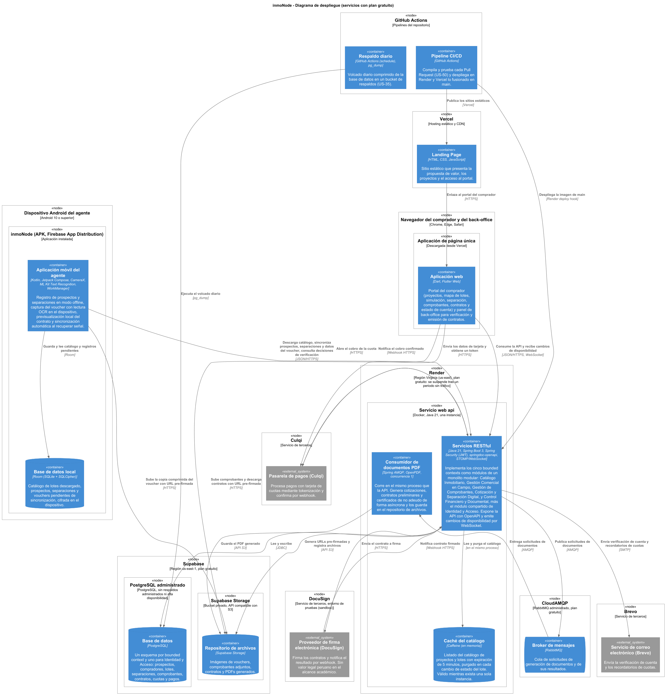

### 4.2. Landing Page & Mobile Application Implementation

La implementación se organiza a partir del Product Backlog. Cada Sprint relaciona sus historias con las evidencias de desarrollo, pruebas, documentación y despliegue de la Landing Page, las aplicaciones y los Web Services.

#### 4.2.1. Sprint 1

El Sprint 1 reúne el alta de proyectos, el registro de lotes, la publicación del catálogo, la presentación de InmoNode en la Landing Page, la exploración de proyectos y el registro local de prospectos. Su valor es preparar una oferta inmobiliaria publicable y conservar las oportunidades comerciales captadas en campo sin conexión.

##### 4.2.1.1. Sprint Planning 1

En el Sprint Planning 1 el equipo seleccionó del Product Backlog ([Tabla 2.60](Chapter-02.md#tabla-2-60)) seis historias que suman 21 Story Points: US-51, US-52, US-53, US-P01, US-15 y US-04. US-05 y US-06 se asignaron inicialmente al Sprint 2; en el Sprint Planning 2, ambas pasaron al Sprint 3. La [Tabla 4.6](#tabla-4-6) resume la reunión.

<a id="tabla-4-6"></a>

**Tabla 4.6**

*Resumen del Sprint Planning 1*

| Campo | Contenido |
|:---|:---|
| **Sprint #** | Sprint 1 |
| **Sprint Planning Background** | |
| Date | 2026-10-05 |
| Time | 08:00 PM |
| Location | Reunión virtual |
| Prepared By | Perez Encarnacion, Breithner Rodolfo |
| Attendees (to planning meeting) | Caisahuana Osores, Becker Junior / Capillo Lema, Mía Valentina / Nuñez Soto, Andy Arturo / Rocca Mariaca, Angel Mathias |
| Sprint n – 1 Review Summary | No aplica: el Sprint 1 es el primer Sprint del proyecto. El punto de partida es el Product Backlog priorizado y el diseño de los capítulos II y III. |
| Sprint n – 1 Retrospective Summary | No aplica: la primera retrospectiva se realiza al cierre del Sprint 1 y se registra en el Sprint Planning 2. |
| **Sprint Goal & User Stories** | US-51, US-52, US-53, US-P01, US-15 y US-04 |
| Sprint 1 Goal | *Our focus is on* preparing a publishable real estate catalog, presenting InmoNode through its Landing Page and letting field sales agents register prospects without connectivity. *We believe it delivers* a first verifiable offer of projects and lots to buyers and investors, and no lost sales opportunities to field sales agents. *This will be confirmed when* a catalog administrator publishes a project with its lots, a visitor reaches the published projects from the Landing Page, and an agent saves a prospect offline that remains on the device after restarting the app. |
| Sprint 1 Velocity | 21 Story Points |
| Sum of Story Points | 21 Story Points (3 + 5 + 2 + 3 + 3 + 5) |

##### 4.2.1.2. Aspect Leaders and Collaborators

La Leadership-and-Collaboration Matrix (LACX) del Sprint 1 considera cinco aspectos: la Landing Page (US-P01), los bounded contexts del backend para el alta, la publicación y la exploración del catálogo (US-51, US-52, US-53 y US-15), la interfaz de la aplicación móvil para el registro de prospectos (US-04), el testing y el deployment. La [Tabla 4.7](#tabla-4-7) indica el líder (L), que coordina contratos, revisión y entrega del aspecto, y los colaboradores (C).

<a id="tabla-4-7"></a>

**Tabla 4.7**

*Leadership-and-Collaboration Matrix del Sprint 1*

| Team Member | GitHub Username | Landing Page | Backend Bounded Contexts | Mobile App UI | Testing | Deployment |
|:---|:---|:---:|:---:|:---:|:---:|:---:|
| Caisahuana Osores, Becker Junior | becker693 | C | L | C | C | C |
| Capillo Lema, Mía Valentina | MiaCL-5 | C | C | C | L | C |
| Nuñez Soto, Andy Arturo | arturo-ns | C | C | C | C | L |
| Perez Encarnacion, Breithner Rodolfo | Breithner1 | L | C | C | C | C |
| Rocca Mariaca, Angel Mathias | MRMpro13 | C | C | L | C | C |

Las tareas del Sprint Backlog se asignan según esta matriz. US-01, US-02 y US-14 son dependencias de las historias del Sprint cuando corresponde; US-05, US-06 y el prototipo de US-47 no forman parte de las entregas del Sprint 1.

##### 4.2.1.3. Sprint Backlog 1

El objetivo del Sprint 1 es dejar publicable el catálogo inmobiliario, presentar InmoNode en la Landing Page y permitir el registro de prospectos sin conexión. El Sprint Backlog descompone las seis historias en 23 tareas, todas estimadas entre 4 y 8 horas, con un total de 122 horas. El tablero está disponible en [Trello: NovaCorp-InmoNode Sprint 1](https://trello.com/b/zF1oDRW8/novacorp-inmonode-sprint-1) y la [Figura 4.2](#figura-4-2) muestra su estado al 2026-10-09.

<a id="figura-4-2"></a>

**Figura 4.2**

*Tablero del Sprint 1 en Trello al 2026-10-09*

<p align="center">
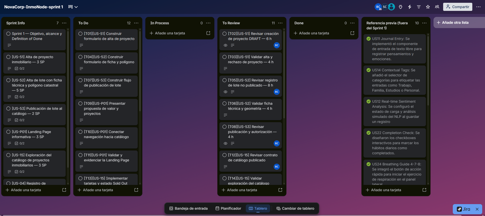
</p>

El tablero contiene el objetivo y la Definition of Done, las seis historias con sus criterios de aceptación y las 23 tareas con su descripción, estimación y responsable. A la fecha de la captura se registran 12 tareas en To Do y 11 en To Review. La [Tabla 4.8](#tabla-4-8) presenta el control de estado de cada tarea.

<a id="tabla-4-8"></a>

**Tabla 4.8**

*Sprint Backlog 1*

| User Story | Work-Item / Task | Description | Estimation (Hours) | Assigned To | Status |
|:---|:---|:---|:---:|:---|:---|
| **Sprint #** | **Sprint 1** | | | | |
| US-51 Alta de proyecto inmobiliario | T01 Construir formulario de alta de proyecto | Capturar nombre, ubicación y etapas; mostrar campos requeridos y resultado del alta. | 6 | Breithner Perez | To Do |
| US-51 Alta de proyecto inmobiliario | T02 Revisar creación de proyecto DRAFT | Revisar POST /api/v1/catalog/projects, validaciones, etapas y persistencia en RealEstateCatalogController. | 6 | Becker Caisahuana (colabora Angel Rocca) | To Review |
| US-51 Alta de proyecto inmobiliario | T03 Validar alta y rechazo de proyecto | Revisar ProjectTest, etapas obligatorias o duplicadas y flujo con PostgreSQL; adjuntar la aceptación del formulario. | 4 | Mía Capillo (colabora Becker Caisahuana) | To Review |
| US-52 Alta de lote con ficha técnica y polígono catastral | T04 Construir formulario de ficha y polígono | Capturar código, etapa, área, dimensiones, precio y polígono; presentar errores de geometría. | 6 | Breithner Perez | To Do |
| US-52 Alta de lote con ficha técnica y polígono catastral | T05 Revisar registro de lote no publicado | Revisar el alta de lotes y la consulta administrativa; guardar DRAFT y rechazar etapa ajena o código duplicado. | 8 | Becker Caisahuana (colabora Angel Rocca) | To Review |
| US-52 Alta de lote con ficha técnica y polígono catastral | T06 Validar ficha técnica y geometría | Ejecutar pruebas de Polygon, coordenadas, lote DRAFT y rechazo HTTP de polígono inválido. | 4 | Mía Capillo (colabora Becker Caisahuana) | To Review |
| US-53 Publicación de lote al catálogo | T07 Construir flujo de publicación de lote | Permitir confirmar la publicación en el back-office y mostrar errores por datos incompletos. | 6 | Breithner Perez | To Do |
| US-53 Publicación de lote al catálogo | T08 Revisar publicación y autorización | Revisar la publicación de proyecto y lote, la transición a AVAILABLE, el rol de administrador de catálogo y la idempotencia sin reiniciar lotes bloqueados. | 4 | Becker Caisahuana (colabora Mía Capillo) | To Review |
| US-P01 Landing Page informativa | T09 Presentar propuesta de valor y proyectos | Construir la vista pública con propuesta de valor, proyectos destacados y llamadas a la acción. | 6 | Breithner Perez | To Do |
| US-P01 Landing Page informativa | T10 Conectar navegación hacia catálogo | Verificar los botones de proyecto y Cotizar; documentar la dependencia de US-14 para el acceso. | 4 | Breithner Perez | To Do |
| US-P01 Landing Page informativa | T11 Validar y evidenciar la Landing Page | Revisar la vista sin sesión, la navegación y la adaptación a móvil; adjuntar capturas y resultado de aceptación. | 4 | Mía Capillo (colabora Becker Caisahuana) | To Do |
| US-15 Exploración del catálogo de proyectos inmobiliarios | T12 Revisar contrato de catálogo publicado | Verificar listado y detalle, rango de precios, disponibilidad y exclusión de borradores. | 6 | Becker Caisahuana (colabora Angel Rocca) | To Review |
| US-15 Exploración del catálogo de proyectos inmobiliarios | T13 Implementar tarjetas y estado Sold Out | Consumir el catálogo con miniatura, precios y disponibilidad; mantener visibles los proyectos vendidos con su etiqueta. | 6 | Breithner Perez | To Do |
| US-15 Exploración del catálogo de proyectos inmobiliarios | T14 Validar exploración del catálogo | Revisar ProjectCatalogIntegrationTest y validar tarjetas con y sin stock en el cliente. | 4 | Mía Capillo (colabora Becker Caisahuana) | To Review |
| US-04 Registro de prospectos offline | T15 Construir formulario y validación local | Capturar nombre, documento y teléfono; impedir el guardado sin documento obligatorio. | 6 | Angel Rocca | To Do |
| US-04 Registro de prospectos offline | T16 Persistir prospecto y operación para sincronización | Guardar el registro y la cola local; comprobar su permanencia después de cerrar y abrir la app sin red. | 8 | Angel Rocca | To Do |
| US-04 Registro de prospectos offline | T17 Revisar recepción de prospectos en backend | Revisar Prospect, ProspectCommandServiceImpl y la persistencia idempotente como soporte a la sincronización. | 4 | Becker Caisahuana (colabora Angel Rocca) | To Review |
| US-04 Registro de prospectos offline | T18 Probar registro de prospectos | Revisar ProspectTest y la integración; documentar la aceptación offline y el rechazo sin documento en Android. | 4 | Mía Capillo (colabora Becker Caisahuana) | To Review |
| Transversal: Testing | T19 Completar aceptación automatizada BDD | Implementar los archivos .feature, los Steps y el runner para las seis historias; ejecutar y adjuntar resultados. | 8 | Mía Capillo (colabora el equipo) | To Do |
| Transversal: Documentation | T20 Revisar y capturar OpenAPI | Verificar esquemas, roles y respuestas del catálogo administrativo y público y de prospectos; capturar Swagger. | 4 | Becker Caisahuana | To Review |
| Transversal: Deployment | T21 Publicar y verificar Landing Page | Registrar proveedor, configuración y URL; comprobar el acceso público y adjuntar evidencia. | 4 | Andy Nuñez (colabora Breithner Perez) | To Do |
| Transversal: Deployment | T22 Verificar entorno backend y automatización | Revisar Dockerfile, Compose y CI; ejecutar en el entorno disponible y registrar health y resultados. | 6 | Andy Nuñez (colabora Becker Caisahuana) | To Review |
| Transversal: Deployment | T23 Instalar y demostrar registro offline Android | Registrar APK, versión y dispositivo; demostrar US-04 sin conexión y adjuntar capturas y video. | 4 | Andy Nuñez (colabora Angel Rocca) | To Do |

##### 4.2.1.4. Development Evidence for Sprint Review

Durante el Sprint se implementaron las operaciones del catálogo en el backend y el registro local de prospectos en la aplicación Android. Esta sección relaciona los commits de cada producto con las historias del Sprint.

**Backend**

La revisión del backend corresponde a la rama `develop` en el commit [207b208](https://github.com/1ACC0238-2620-13981-NovaCorp-InmoNode/InmoNode-Backend/commit/207b20820d5f2e12e4bd1ab09e95a4378751c6fe). Implementa el alta de proyectos con etapas (US-51), el registro individual de lotes DRAFT (US-52), la publicación como AVAILABLE (US-53), la consulta pública del catálogo (US-15) y la recepción de prospectos en el servidor como soporte a US-04. RealEstateCatalogController, incorporado en el commit 2b213d2, expone las operaciones administrativas; el catálogo reside todavía en el paquete `financial`, por lo que la separación completa en bounded contexts queda pendiente. La [Tabla 4.9](#tabla-4-9) lista los commits de implementación.

<a id="tabla-4-9"></a>

**Tabla 4.9**

*Commits de implementación del backend en el Sprint 1*

| Repository | Branch | Commit Id | Commit Message | Commit Message Body | Committed on (Date) |
|:---|:---|:---|:---|:---|:---|
| InmoNode-Backend | feature/FINANCIAL → develop | [d4099d1](https://github.com/1ACC0238-2620-13981-NovaCorp-InmoNode/InmoNode-Backend/commit/d4099d1c07b35f9a57f5c60d37b245c8ceabb468) | feat(financial): import project lots from a GeoJSON plan | — | 2026-10-07 |
| InmoNode-Backend | feature/FINANCIAL → develop | [b3ce1f6](https://github.com/1ACC0238-2620-13981-NovaCorp-InmoNode/InmoNode-Backend/commit/b3ce1f6da2e2567b40324ebc67507b928e96f8d5) | feat(financial): expose the published project catalog | — | 2026-10-07 |
| InmoNode-Backend | feature/FIELD-SYNC → develop | [6d30f26](https://github.com/1ACC0238-2620-13981-NovaCorp-InmoNode/InmoNode-Backend/commit/6d30f2699e6f7a4e98c121f5ea7254553ebf5a55) | feat(catalog): register field prospects | — | 2026-10-07 |
| InmoNode-Backend | feature/FIELD-SYNC → develop | [167d5f6](https://github.com/1ACC0238-2620-13981-NovaCorp-InmoNode/InmoNode-Backend/commit/167d5f6d2495640357f3bce18968d2ef3b17a065) | feat(financial): consolidate field reservations | — | 2026-10-07 |
| InmoNode-Backend | feature/FIELD-SYNC → develop | [211bdb0](https://github.com/1ACC0238-2620-13981-NovaCorp-InmoNode/InmoNode-Backend/commit/211bdb05868ec0685e9ef9e3e6f676f6127f9f81) | feat(catalog): sync offline records from the field app | — | 2026-10-07 |
| InmoNode-Backend | feature/health-check-and-api-docs → develop | [2b213d2](https://github.com/1ACC0238-2620-13981-NovaCorp-InmoNode/InmoNode-Backend/commit/2b213d2f77c90f2effdfc55846625cf0e1bd2ff4) | feat(initial):fixed | — | 2026-10-09 |

Las ramas de procedencia se identifican por los merges de los pull requests [#3](https://github.com/1ACC0238-2620-13981-NovaCorp-InmoNode/InmoNode-Backend/pull/3), [#4](https://github.com/1ACC0238-2620-13981-NovaCorp-InmoNode/InmoNode-Backend/pull/4) y [#9](https://github.com/1ACC0238-2620-13981-NovaCorp-InmoNode/InmoNode-Backend/pull/9). Las fechas corresponden al autor del commit en la zona horaria GMT-5. Los commits del Sprint no registran cuerpo de mensaje (—).

**Aplicación móvil Android**

La revisión de la aplicación corresponde a la rama `develop` en el commit [8335b96](https://github.com/1ACC0238-2620-13981-NovaCorp-InmoNode/InmoNode-Mobile/tree/8335b964730bc15c768b158a862ff8daf3b7ec8d). Se desarrolla en Kotlin con Jetpack Compose, Hilt y Room. El avance de US-04 comprende el formulario de registro de prospectos, la validación de datos, su almacenamiento local y el seguimiento de los registros por sincronizar. El cliente utiliza `https://inmonode-backend.onrender.com/api/v1/` como dirección base de los servicios.

El flujo utiliza `ProspectFormScreen`, `ProspectsViewModel` y `RegisterProspectUseCase`. El repositorio `ProspectRepositoryImpl` exige una sesión de agente, valida un documento de 8 a 12 caracteres alfanuméricos y un nombre de hasta 150 caracteres, y valida el teléfono cuando se proporciona. El guardado genera un UUID y registra el prospecto en una transacción local, sin llamada de red. `ProspectEntity` conserva el propietario, los datos de contacto, la fecha y el indicador `synced = false`; `ProspectDao` e `InmoNodeDatabase` proporcionan la persistencia con Room. El ViewModel observa los registros locales, informa la conectividad y conserva los campos del formulario mediante `SavedStateHandle`.

Como soporte para la sincronización (US-11, Sprint 3), `FieldSyncRepositoryImpl` selecciona los prospectos sin sincronizar, los envía en lotes al backend y actualiza su estado local después de validar la respuesta; si la solicitud falla, los registros conservan su estado para un nuevo intento. `PortfolioRepositoryImpl` descarga y almacena localmente proyectos y lotes, con manejo de ETag y respuesta 304. La [Tabla 4.10](#tabla-4-10) lista los commits de la aplicación.

<a id="tabla-4-10"></a>

**Tabla 4.10**

*Commits de implementación de la aplicación Android en el Sprint 1*

| Repository | Branch | Commit Id | Commit Message | Commit Message Body | Committed on (Date) |
|:---|:---|:---|:---|:---|:---|
| InmoNode-Mobile | feature/US-01-login → develop | [79af30f](https://github.com/1ACC0238-2620-13981-NovaCorp-InmoNode/InmoNode-Mobile/commit/79af30f5559f480473fde8f526674f42f511e065) | feat(fieldsales): update ProspectFormScreen.kt | — | 2026-10-09 |
| InmoNode-Mobile | feature/US-01-login → develop | [c0bce40](https://github.com/1ACC0238-2620-13981-NovaCorp-InmoNode/InmoNode-Mobile/commit/c0bce4034a47f5a8ed0b509c7ce1205d364f12c5) | feat(fieldsales): update ProspectsViewModel.kt | — | 2026-10-09 |
| InmoNode-Mobile | feature/US-01-login → develop | [848150d](https://github.com/1ACC0238-2620-13981-NovaCorp-InmoNode/InmoNode-Mobile/commit/848150d800cfff7b5f374d2ec68fa25bac6fa825) | feat(fieldsales): update ProspectRepositoryImpl.kt | — | 2026-10-09 |
| InmoNode-Mobile | feature/US-01-login → develop | [ddd40a7](https://github.com/1ACC0238-2620-13981-NovaCorp-InmoNode/InmoNode-Mobile/commit/ddd40a7f11e21c92c714f290712b9a71e7c0b5ee) | feat(fieldsales): update ProspectEntity.kt | — | 2026-10-09 |
| InmoNode-Mobile | feature/US-01-login → develop | [7c8b606](https://github.com/1ACC0238-2620-13981-NovaCorp-InmoNode/InmoNode-Mobile/commit/7c8b606e5bfe27332b68beb6bd5dbc076711da2a) | feat(fieldsales): update ProspectDao.kt | — | 2026-10-09 |
| InmoNode-Mobile | feature/US-01-login → develop | [0dd7707](https://github.com/1ACC0238-2620-13981-NovaCorp-InmoNode/InmoNode-Mobile/commit/0dd7707932e5b62758f9c05ddb1f2e0634818f06) | feat(database): update InmoNodeDatabase.kt | — | 2026-10-09 |
| InmoNode-Mobile | feature/US-01-login → develop | [c1b6e5c](https://github.com/1ACC0238-2620-13981-NovaCorp-InmoNode/InmoNode-Mobile/commit/c1b6e5c8f3a4485eaffc66a1b1dce097fd7d3cf6) | feat(fieldsales): update FieldSyncRepositoryImpl.kt | — | 2026-10-09 |
| InmoNode-Mobile | feature/US-01-login → develop | [c752de2](https://github.com/1ACC0238-2620-13981-NovaCorp-InmoNode/InmoNode-Mobile/commit/c752de24b3ffc0a09d18404a7f96cd45c4ffb753) | feat(fieldsales): update PortfolioRepositoryImpl.kt | — | 2026-10-09 |
| InmoNode-Mobile | feature/US-01-login → develop | [03d510e](https://github.com/1ACC0238-2620-13981-NovaCorp-InmoNode/InmoNode-Mobile/commit/03d510e545e5eee930979d66420f6f9a9074eaef) | fix(iam): update AuthRepositoryImpl.kt | — | 2026-10-09 |
| InmoNode-Mobile | feature/US-01-login → develop | [7a6a32f](https://github.com/1ACC0238-2620-13981-NovaCorp-InmoNode/InmoNode-Mobile/commit/7a6a32f2d66cff8ec4bb8e07a9b6732d65c4c693) | feat(di): update NetworkModule.kt | — | 2026-10-09 |
| InmoNode-Mobile | feature/US-01-login → develop | [8335b96](https://github.com/1ACC0238-2620-13981-NovaCorp-InmoNode/InmoNode-Mobile/commit/8335b964730bc15c768b158a862ff8daf3b7ec8d) | Merge pull request #4 from 1ACC0238-2620-13981-NovaCorp-InmoNode/feature/US-01-login | Feature/us 01 login | 2026-10-09 |

Los commits forman parte del historial integrado mediante el [pull request #4](https://github.com/1ACC0238-2620-13981-NovaCorp-InmoNode/InmoNode-Mobile/pull/4). Aunque la rama de origen se denomina `feature/US-01-login`, también contiene los cambios de `fieldsales`, persistencia y red. Las fechas se expresan en GMT-5. La ejecución de estos flujos en el dispositivo se presenta en la sección 4.2.1.6.

##### 4.2.1.5. Testing Suite Evidence for Sprint Review

Se ejecutaron 53 pruebas de dominio y de controladores y, por separado, tres pruebas de integración contra PostgreSQL 18.6 en la base aislada `inmonode_jpa_validation`: **56 pruebas sin fallos, errores ni omisiones**. Para las historias de alta y publicación se ejecutaron además siete pruebas de alta, publicación y autorización, con lo que se comprobaron **63 casos sin fallos, errores ni omisiones**. Maven compiló fuentes y pruebas con release 21 usando JetBrains Runtime 25.0.3. La selección incluye reglas de soporte y casos técnicos adicionales, por lo que no equivale a 63 pruebas de aceptación de las seis historias. Las tres pruebas de integración locales simulan ObjectStorage. La suite completa con Testcontainers no se ejecutó en esta revisión porque Docker Engine no estaba disponible.

La [Tabla 4.11](#tabla-4-11) relaciona cada prueba con su historia, la clase y el comportamiento comprobado. Los archivos se encuentran en [src/test/java/com/novacorp/inmonode/inmonodebackend](https://github.com/1ACC0238-2620-13981-NovaCorp-InmoNode/InmoNode-Backend/tree/207b20820d5f2e12e4bd1ab09e95a4378751c6fe/src/test/java/com/novacorp/inmonode/inmonodebackend), dentro de los paquetes `catalog`, `financial` y `shared`.

<a id="tabla-4-11"></a>

**Tabla 4.11**

*Pruebas automatizadas del backend en el Sprint 1*

| Test Id | Type | User Story | Class and behavior | Test file | Result |
|:---|:---|:---|:---|:---|:---|
| TS01 | Unit | US-04 (reglas de soporte) | Prospect: normalización, documento obligatorio, teléfono y actualización de contacto. | Prospect<wbr>Test.<wbr>java | 4 casos aprobados. |
| TS02 | Unit | US-52 | LotBoundary y GeoPoint: validez del polígono y de las coordenadas. | Lot<wbr>Boundary<wbr>Test.<wbr>java, Geo<wbr>Point<wbr>Test.<wbr>java | 5 + 2 casos aprobados. |
| TS03 | Unit | US-52, US-53 | Lot: dimensiones, estado y bloqueo. | LotTest.java | 12 casos aprobados. |
| TS04 | Unit | US-15 | Project y LotStatistics: publicación y cálculo de disponibilidad. | Project<wbr>Test.<wbr>java, Lot<wbr>Statistics<wbr>Test.<wbr>java | 4 + 2 casos aprobados. |
| TS05 | Unit | Soporte de reservas (Sprint 3) | Reservation: identificadores de campo, estados y vigencia. | Reservation<wbr>Test.<wbr>java | 17 casos aprobados. |
| TS06 | Unit / MVC slice | Soporte de consulta (filtros de US-16) | Validación de rangos y viewport con colaboradores simulados. | Project<wbr>Lots<wbr>Filters<wbr>Test.<wbr>java | 3 casos aprobados. |
| TS07 | Unit / MVC slice | Transversal | Health<wbr>Controller: 200 con base disponible y 503 ante fallo de la base. | Health<wbr>Controller<wbr>Test.<wbr>java | 4 casos aprobados. |
| TS08 | Integration | US-51, US-52, US-53; soporte de US-04 | Flujo persistente web, rechazo y sustitución de evidencia, y validación y rollback de la sincronización de campo. | Local<wbr>Postgres<wbr>Flow<wbr>Integration<wbr>Test.<wbr>java | 3 casos aprobados con PostgreSQL real y ObjectStorage simulado. |
| TS09 | Integration | US-15 | Catálogo publicado, borradores ocultos, Sold Out y GeoJSON por código. | Project<wbr>Catalog<wbr>Integration<wbr>Test.<wbr>java | No ejecutada: requiere Docker para Testcontainers. |
| TS10 | Integration | US-04 (recepción en servidor) | Alta y actualización de prospectos por UUID. | Prospect<wbr>Registration<wbr>Integration<wbr>Test.<wbr>java | No ejecutada: requiere Docker para Testcontainers. |
| TS11 | Integration | Soporte de US-11 y US-12 (Sprint 3) | Consolidación, conflictos, duplicados y autorización del lote sincronizado. | Reservation<wbr>Consolidation<wbr>Integration<wbr>Test.<wbr>java, Field<wbr>Records<wbr>Controller<wbr>Integration<wbr>Test.<wbr>java | No ejecutada: requiere Docker para Testcontainers. |
| TS12 | Unit | US-51, US-52, US-53 | Etapas normalizadas y únicas; alta de lote DRAFT; bloqueo de etapa ajena y de código duplicado; la publicación requiere proyecto publicado y no reinicia BLOCKED. | Individual<wbr>Lot<wbr>Publication<wbr>Test.<wbr>java | 4 casos aprobados con repositorios simulados. |
| TS13 | Unit / MVC slice | US-51, US-52, US-53 | Rechazo 400 por etapas ausentes o duplicadas y polígono cruzado; BUYER recibe 403 en el inventario y la publicación administrativos. | Individual<wbr>Catalog<wbr>Authorization<wbr>Test.<wbr>java | 3 casos aprobados con servicios simulados. |

Las pruebas se reproducen desde el backend con un JDK 21 o posterior:

```powershell
.\mvnw.cmd --batch-mode --no-transfer-progress '-Dtest=ProspectTest,LotTest,LotBoundaryTest,GeoPointTest,ProjectTest,LotStatisticsTest,ReservationTest,HealthControllerTest,ProjectLotsFiltersTest' test

# Solo contra la base aislada de pruebas previamente disponible.
$env:INMONODE_VALIDATION_DB_URL='jdbc:postgresql://127.0.0.1:55432/inmonode_jpa_validation'
$env:INMONODE_VALIDATION_DB_USER='inmonode_test'
.\mvnw.cmd --batch-mode --no-transfer-progress '-Dtest=LocalPostgresFlowIntegrationTest' test

.\mvnw.cmd --batch-mode --no-transfer-progress '-Dtest=IndividualLotPublicationTest,IndividualCatalogAuthorizationTest' test

# Suite completa: requiere Docker operativo.
.\mvnw.cmd --batch-mode --no-transfer-progress verify
```

**Especificaciones de aceptación.** Los escenarios Gherkin siguientes describen el comportamiento esperado de las historias del Sprint y son la base de los archivos `.feature` de la tarea T19:

```gherkin
@US-P01
Feature: Informative landing page
  Scenario: Show the public value proposition
    Given a visitor has not signed in
    When the visitor opens the landing page
    Then the value proposition and featured projects are visible
    And the visitor can navigate to the catalog or registration flow

  Scenario: Navigate from a featured project
    Given a visitor is viewing a featured project on the landing page
    When the visitor selects the project or the "Cotizar" action
    Then the catalog exploration flow is opened
    And registration is requested if the visitor has not signed in

@US-15
Feature: Explore real estate projects
  Scenario: Show active project information
    Given the buyer has signed in
    When the buyer opens the project catalog
    Then active projects display a representative thumbnail
    And each project shows its price range and availability percentage

  Scenario: Keep a sold out project visible
    Given the buyer has signed in
    And all lots of a published project are sold
    When the buyer opens the project catalog
    Then the project remains visible
    And its availability is zero and its card shows "Sold Out"

@US-04
Feature: Register prospects offline
  Scenario: Keep a prospect after restarting without connectivity
    Given the field app is offline
    When the agent saves a prospect with name, document and phone
    And restarts the app while still offline
    Then the prospect remains in the local database
    And its synchronization operation is pending

  Scenario: Reject a prospect without its document
    Given the field app is offline
    When the agent tries to save a prospect without a document
    Then no prospect is saved and a required document message is shown

@US-51
Feature: Register a real estate project
  Scenario: Create a draft project
    Given the catalog administrator provides a valid name, location and stages
    When the administrator registers the project
    Then the project is created as DRAFT and allows lot registration

  Scenario: Reject incomplete project data
    Given a catalog administrator omits the required location
    When the administrator tries to register the project
    Then no project is created and the missing field is reported

@US-52
Feature: Register an unpublished lot
  Scenario: Create a complete lot in an existing project
    Given an existing project and a valid stage
    When the administrator submits code, dimensions, area, price and polygon
    Then the lot is stored as DRAFT and linked to the project
    And the lot is not offered for separation

  Scenario: Reject an invalid polygon
    Given the lot coordinates do not form a valid closed polygon
    When the administrator tries to register the lot
    Then no lot is stored and a polygon validation message is shown

@US-53
Feature: Publish a complete lot
  Scenario: Expose a complete lot as available
    Given a draft lot has a valid project, price and polygon
    And its project is published
    When the administrator publishes the lot
    Then the lot becomes AVAILABLE and appears in the public catalog

  Scenario: Reject incomplete publication
    Given a lot is missing the required polygon or price
    When the administrator tries to publish the lot
    Then publication is blocked and the missing data is reported
```

La [Tabla 4.12](#tabla-4-12) lista los commits que incorporaron las pruebas.

<a id="tabla-4-12"></a>

**Tabla 4.12**

*Commits relacionados con pruebas en el Sprint 1*

| Repository | Branch | Commit Id | Commit Message | Commit Message Body | Committed on (Date) |
|:---|:---|:---|:---|:---|:---|
| Inmo<wbr>Node-<wbr>Backend | feature/<wbr>FINANCIAL → develop | [b3ce1f6](https://github.com/1ACC0238-2620-13981-NovaCorp-InmoNode/InmoNode-Backend/commit/b3ce1f6da2e2567b40324ebc67507b928e96f8d5) | feat(<wbr>financial): expose the published project catalog | — (incluye Project<wbr>Catalog<wbr>Integration<wbr>Test y Lot<wbr>Statistics<wbr>Test) | 2026-10-07 |
| Inmo<wbr>Node-<wbr>Backend | feature/<wbr>FINANCIAL → develop | [d4099d1](https://github.com/1ACC0238-2620-13981-NovaCorp-InmoNode/InmoNode-Backend/commit/d4099d1c07b35f9a57f5c60d37b245c8ceabb468) | feat(<wbr>financial): import project lots from a GeoJSON plan | — (incluye LotTest y Lot<wbr>Boundary<wbr>Test) | 2026-10-07 |
| Inmo<wbr>Node-<wbr>Backend | feature/<wbr>FIELD-<wbr>SYNC → develop | [6d30f26](https://github.com/1ACC0238-2620-13981-NovaCorp-InmoNode/InmoNode-Backend/commit/6d30f2699e6f7a4e98c121f5ea7254553ebf5a55) | feat(catalog): register field prospects | — (incluye ProspectTest y Prospect<wbr>Registration<wbr>Integration<wbr>Test) | 2026-10-07 |
| Inmo<wbr>Node-<wbr>Backend | feature/<wbr>FIELD-<wbr>SYNC → develop | [167d5f6](https://github.com/1ACC0238-2620-13981-NovaCorp-InmoNode/InmoNode-Backend/commit/167d5f6d2495640357f3bce18968d2ef3b17a065) | feat(<wbr>financial): consolidate field reservations | — (incluye Reservation<wbr>Consolidation<wbr>Integration<wbr>Test) | 2026-10-07 |
| Inmo<wbr>Node-<wbr>Backend | feature/<wbr>health-<wbr>check-<wbr>and-<wbr>api-<wbr>docs → develop | [2b213d2](https://github.com/1ACC0238-2620-13981-NovaCorp-InmoNode/InmoNode-Backend/commit/2b213d2f77c90f2effdfc55846625cf0e1bd2ff4) | feat(<wbr>initial):<wbr>fixed | — (agrega pruebas de catálogo individual, autorización, health, filtros y flujo PostgreSQL local) | 2026-10-09 |

Los archivos incluidos en cada commit se anotan entre paréntesis porque los commits no registran cuerpo de mensaje. Los resultados de ejecución local no se versionan en el repositorio; su resumen se presenta en esta sección.

##### 4.2.1.6. Execution Evidence for Sprint Review

En el Sprint 1 se implementaron las operaciones del catálogo inmobiliario en los Web Services y el registro offline de prospectos en la aplicación Android. El 2026-10-09 se comprobaron respuestas HTTP 200 en el entorno local de validación (puerto 8081, revisión 207b208) para `GET /health`, el catálogo de proyectos, el detalle del proyecto 1, sus lotes y la especificación OpenAPI. La [Tabla 4.13](#tabla-4-13) resume la ejecución de los Web Services.

<a id="tabla-4-13"></a>

**Tabla 4.13**

*Evidencia de ejecución de los Web Services*

| Producto | Historia | Flujo | Resultado | Evidencia |
|:---|:---|:---|:---|:---|
| Web Services | US-15 | Listado y detalle de proyectos | La consulta devuelve el proyecto de prueba con rango de PEN 45 000, un lote y 0 % de disponibilidad. El detalle del proyecto 1 devuelve PUBLISHED y las etapas Norte y Sur; el lote BLOCKED mantiene `soldOut=false`. | Ejemplo A de la sección 4.2.1.7. |
| Web Services | US-52, US-15 | Consulta de lotes en GeoJSON | La consulta devuelve un FeatureCollection con el lote N-01, un Polygon cerrado, área de 120 m² y estado BLOCKED. | Ejemplo B de la sección 4.2.1.7. |
| Web Services | US-51, US-52, US-53 | Alta y publicación | LocalPostgresFlowIntegrationTest comprueba la creación DRAFT, las etapas, los lotes y la publicación con PostgreSQL; las pruebas adicionales cubren validaciones y autorización. | Tabla 4.11. |
| Web Services | Transversal | Disponibilidad pública | `GET /health` en Render devuelve HTTP 200 con status, API y base de datos UP. | Figura 4.31. |

Las figuras 4.3 a 4.10 muestran las vistas de la aplicación Android ejecutada en un dispositivo físico, en el orden del flujo de acceso, registro de prospectos y consulta de su estado. El formulario, la validación, el guardado sin conexión y la lista posterior corresponden a US-04; el mapa, la sincronización y el perfil son capacidades de soporte para los siguientes Sprints.

Acceso del agente a la aplicación con sus credenciales.

<a id="figura-4-3"></a>

**Figura 4.3**

*Inicio de sesión*

<p align="center">
  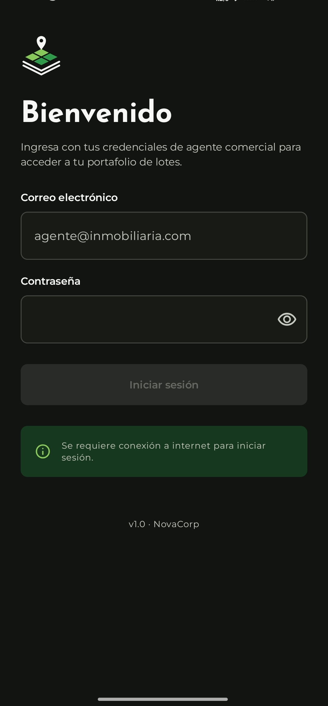
</p>

Mapa catastral con los filtros de lotes y la acción para descargar el portafolio cuando todavía no hay datos locales.

<a id="figura-4-4"></a>

**Figura 4.4**

*Mapa catastral*

<p align="center">
  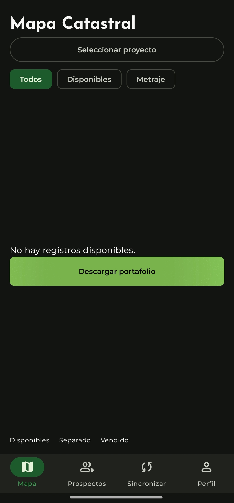
</p>

Lista de los prospectos registrados por el agente (US-04).

<a id="figura-4-5"></a>

**Figura 4.5**

*Lista de prospectos (US-04)*

<p align="center">
  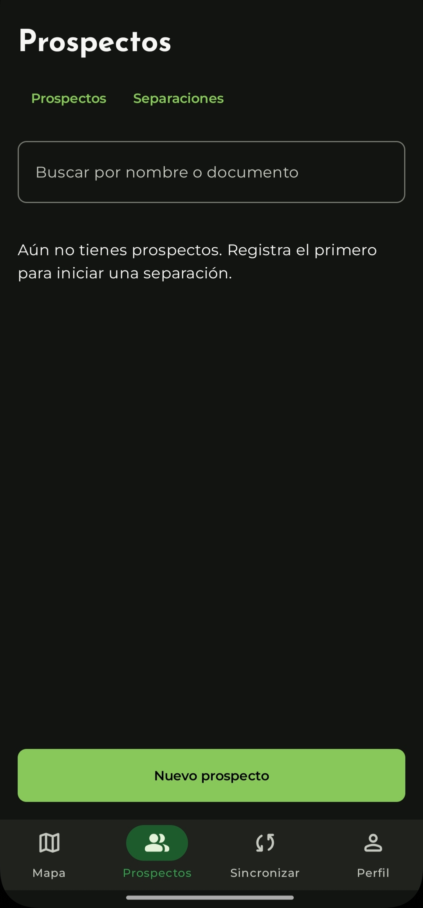
</p>

Formulario con los datos del prospecto y el banner de «Modo sin conexión» (US-04).

<a id="figura-4-6"></a>

**Figura 4.6**

*Formulario de registro de prospecto (US-04)*

<p align="center">
  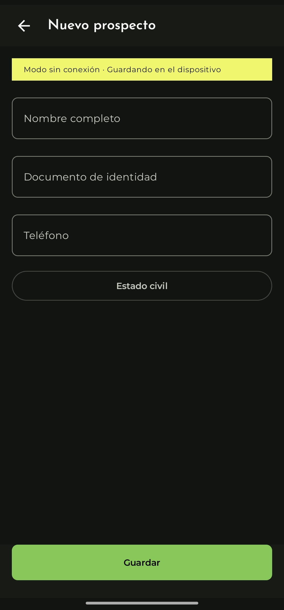
</p>

Mensaje de validación al intentar guardar un prospecto sin documento de identidad (US-04, escenario 2).

<a id="figura-4-7"></a>

**Figura 4.7**

*Validación del documento obligatorio (US-04)*

<p align="center">
  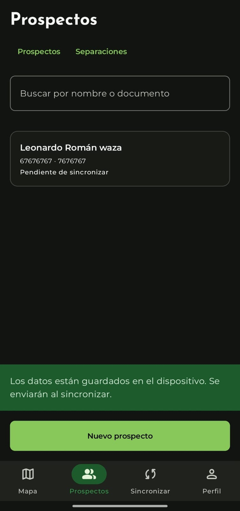
</p>

Lista de prospectos después de guardar el registro sin conexión (US-04, escenario 1).

<a id="figura-4-8"></a>

**Figura 4.8**

*Prospecto guardado sin conexión (US-04)*

<p align="center">
  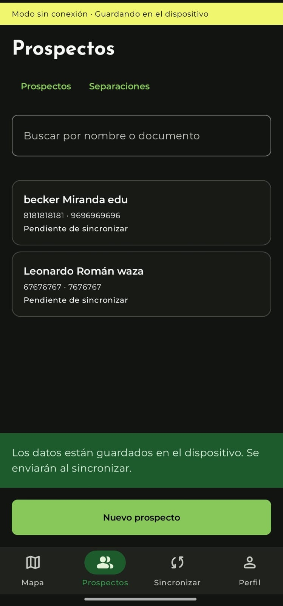
</p>

Estado de los registros pendientes y de las operaciones de sincronización.

<a id="figura-4-9"></a>

**Figura 4.9**

*Estado de sincronización*

<p align="center">
  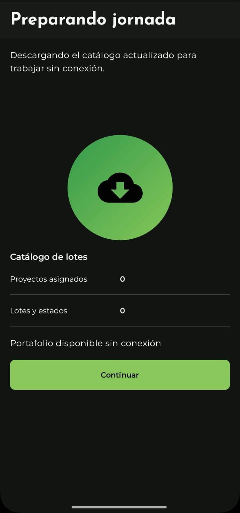
</p>

Información de la sesión del agente y opción de cierre de sesión.

<a id="figura-4-10"></a>

**Figura 4.10**

*Perfil del agente*

<p align="center">
  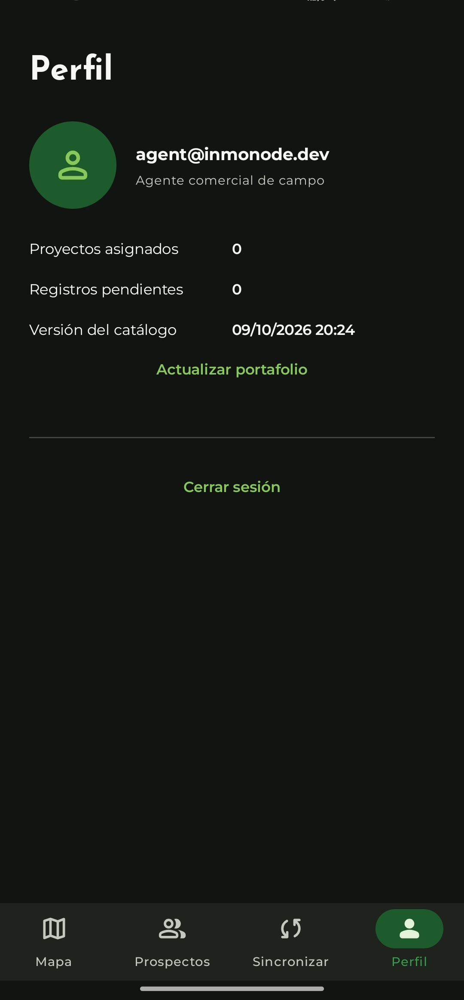
</p>

##### 4.2.1.7. Services Documentation Evidence for Sprint Review

La documentación OpenAPI 3.1 de los Web Services se genera con springdoc-openapi 3.0.3 a partir de las anotaciones de los controladores y está publicada en Swagger UI del servicio desplegado: [inmonode-backend.onrender.com/swagger-ui/index.html](https://inmonode-backend.onrender.com/swagger-ui/index.html). En el Sprint 1 se documentaron el alta y la publicación de proyectos y lotes (US-51, US-52 y US-53), el catálogo público (US-15) y los servicios de soporte para la sincronización de prospectos y la disponibilidad del servicio. Los endpoints se invocan sobre la URL base `https://inmonode-backend.onrender.com`; los endpoints administrativos y de campo requieren un token JWT (`Authorization: Bearer <token>`), y `OpenApiConfiguration` declara el esquema `bearerAuth`. La [Tabla 4.14](#tabla-4-14) presenta las acciones implementadas.

<a id="tabla-4-14"></a>

**Tabla 4.14**

*Endpoints documentados con OpenAPI en el Sprint 1*

| Verbo | Endpoint | Acción implementada | Parámetros | Response y explicación |
|:---|:---|:---|:---|:---|
| POST | /<wbr>api/<wbr>v1/<wbr>catalog/<wbr>projects | Crear proyecto en borrador (US-51) | Token con rol CATALOG_ADMIN; `name`, `location`, `stages` y `financingRules` obligatorios; coordenadas e imagen de portada opcionales (ejemplo E). | 201 con `id`, `status=DRAFT`, etapas y reglas. El proyecto no se publica; datos incompletos o etapas inválidas producen 400. |
| POST | /<wbr>api/<wbr>v1/<wbr>catalog/<wbr>projects/<wbr>{project<wbr>Id}/<wbr>lots | Registrar lote no publicado (US-52) | Token CATALOG_ADMIN; `projectId` en la ruta; `code`, `stageName`, `area`, `price` y `polygon`; `front` y `depth` opcionales (ejemplo F). | 201 con `id`, `projectId`, `status=DRAFT` y geometría. La etapa debe pertenecer al proyecto, el precio y el área deben ser positivos y el polígono válido; un código duplicado produce 409. |
| GET | /<wbr>api/<wbr>v1/<wbr>catalog/<wbr>projects/<wbr>{project<wbr>Id}/<wbr>lots | Consultar inventario administrativo (soporte de US-52) | Token CATALOG_ADMIN; `projectId` en la ruta. | 200 con la lista de lotes, incluidos los DRAFT, para verificarlos antes de publicar. |
| PUT | /<wbr>api/<wbr>v1/<wbr>catalog/<wbr>projects/<wbr>{project<wbr>Id}/<wbr>publish | Publicar proyecto (prerrequisito de US-53) | Token CATALOG_ADMIN; `projectId`; sin body. | 200 con <code>status=<wbr>PUBLISHED</code>. Un proyecto sin lotes produce 422. |
| PUT | /<wbr>api/<wbr>v1/<wbr>catalog/<wbr>lots/<wbr>{lot<wbr>Id}/<wbr>publish | Publicar lote (US-53) | Token CATALOG_ADMIN; `lotId`; sin body. | 200 con <code>status=<wbr>AVAILABLE</code> para un lote DRAFT válido. Si el proyecto no está publicado produce 422; repetir la operación no reinicia lotes BLOCKED, RESERVED ni SOLD. |
| GET | /<wbr>api/<wbr>v1/<wbr>projects | Listar proyectos publicados (US-15) | Sin parámetros obligatorios; acceso público. | 200 con id, nombre, ubicación, miniatura, `priceRange`, `totalLots`, <code>availability<wbr>Percentage</code> y `soldOut` (ejemplo A). Puede devolver una lista vacía. |
| GET | /<wbr>api/<wbr>v1/<wbr>projects/<wbr>{project<wbr>Id} | Consultar detalle de proyecto (US-15) | `projectId` en la ruta; público para proyectos publicados y restringido a CATALOG_ADMIN para borradores. | 200 con estado, etapas y reglas financieras (por ejemplo, <code>status=<wbr>PUBLISHED</code>, etapas Norte y Sur, TEA 12 %). Un proyecto inexistente o un borrador no autorizado produce 404. |
| GET | /<wbr>api/<wbr>v1/<wbr>projects/<wbr>{project<wbr>Id}/<wbr>lots | Consultar plano de lotes (US-52, US-15) | `projectId`; filtros opcionales `minArea`, `maxArea`, `minPrice`, `maxPrice`, `status` y viewport (`west`, `south`, `east`, `north` juntos). | 200 con GeoJSON de coordenadas [longitud, latitud], propiedades comerciales y estado (ejemplo B). Sin coincidencias devuelve `features=[]`; rangos inválidos, 400; proyecto no visible, 404. |
| GET | /<wbr>api/<wbr>v1/<wbr>field-<wbr>sync/<wbr>portfolio | Descargar el portafolio para el cliente offline (dependencia de US-02) | Token con rol FIELD_AGENT; `If-None-Match` opcional. | 200 con proyectos, reglas y lotes en GeoJSON, y ETag en el header; 304 sin cuerpo cuando el ETag coincide; 401 sin token (Figura 4.25). |
| POST | /<wbr>api/<wbr>v1/<wbr>field-<wbr>sync | Recibir prospectos y reservas desde campo (US-32; soporte de US-04 y, en el Sprint 3, de US-11 y US-12) | Token FIELD_AGENT y body JSON con hasta 500 prospectos y 200 reservas (ejemplos C y D). | 201 con <code>prospects<wbr>Synced</code> y el resultado por reserva: SYNCED, CONFLICT o DUPLICATE. Un payload inválido produce 400 sin guardar datos. |
| GET | /health | Comprobar disponibilidad (transversal) | Sin autenticación. | 200 con <code>{"status":<wbr>"UP",<wbr>"services":<wbr>{"database":<wbr>"UP",<wbr>"api":<wbr>"UP"}}</code>; 503 si falla PostgreSQL. |

Los ejemplos A y B son respuestas reales obtenidas en el entorno local de validación con datos de prueba. Los ejemplos C a F son requests de referencia para invocar los endpoints de escritura.

**A. Response del catálogo de proyectos:**

```json
[{"id":1,"name":"Validación de etapas","location":"Lima - datos de prueba",
  "latitude":null,"longitude":null,"coverImageUrl":null,
  "priceRange":{"min":45000.00,"max":45000.00,"currency":"PEN"},
  "totalLots":1,"availabilityPercentage":0.00,"soldOut":false}]
```

**B. Response del plano de lotes:**

```json
{"type":"FeatureCollection","features":[{"type":"Feature","id":1,
  "geometry":{"type":"Polygon","coordinates":[[[-76.7,-12.5],[-76.69,-12.5],
    [-76.69,-12.49],[-76.7,-12.49],[-76.7,-12.5]]]},
  "properties":{"code":"N-01","area":120.00,"front":10.00,"depth":12.00,
    "price":45000.00,"currency":"PEN","status":"BLOCKED"}}]}
```

**C. Request de recepción de un prospecto.** `registeredAt` puede omitirse; el documento acepta de 8 a 12 caracteres alfanuméricos, el nombre hasta 150 y el teléfono hasta 20:

```json
{"prospects":[{"id":"11111111-1111-4111-8111-111111111111",
  "document":"12345678","fullName":"Ana Quispe",
  "phone":"+51 987654321","registeredAt":"2026-10-09T08:00:00Z"}],
 "reservations":[]}
```

**D. Registro de reserva dentro del body de sincronización.** Se añade al arreglo `reservations` del ejemplo C con el id de un lote disponible:

```json
{"id":"22222222-2222-4222-8222-222222222222","lotId":2,
 "prospectId":"11111111-1111-4111-8111-111111111111",
 "initialAmount":1500.00,"reservedAt":"2026-10-09T08:05:00Z"}
```

`id` y `prospectId` son UUID generados en el dispositivo; `lotId` y `reservedAt` son obligatorios e `initialAmount` debe ser positivo. Un reintento conserva el mismo UUID. Un resultado SYNCED incluye `reservationStatus` y `blockedUntil`; CONFLICT aporta `conflictReason`; y DUPLICATE informa `originalResult`.

**E. Request de alta de proyecto (US-51):**

```json
{
  "name": "Proyecto de prueba",
  "location": "Lima - datos de prueba",
  "stages": ["Norte", "Sur"],
  "financingRules": {
    "minDownPaymentPercentage": 20,
    "annualInterestRate": 12,
    "maxTermMonths": 120,
    "lateFeeRate": 1.5
  }
}
```

**F. Request de alta de lote (US-52):**

```json
{
  "code": "A-01",
  "stageName": "Norte",
  "area": 120,
  "front": 10,
  "depth": 12,
  "price": 45000,
  "polygon": [[[-76.7, -12.5], [-76.69, -12.5], [-76.69, -12.49], [-76.7, -12.49], [-76.7, -12.5]]]
}
```

En el dominio, DRAFT equivale a «Borrador» para un proyecto y a «No publicado» para un lote; AVAILABLE expresa un lote publicado y disponible para separación.

**Capturas de la documentación en Swagger UI.** Las figuras 4.11 a 4.25 muestran los contratos OpenAPI de alta y publicación del catálogo, las consultas públicas, la sincronización de campo y la disponibilidad del servicio.

Vista general de la documentación: InmoNode-Backend, versión 0.0.1-SNAPSHOT, especificación OAS 3.1 y los grupos de operaciones.

<a id="figura-4-11"></a>

**Figura 4.11**

*Vista general de la documentación OpenAPI*

<p align="center">
  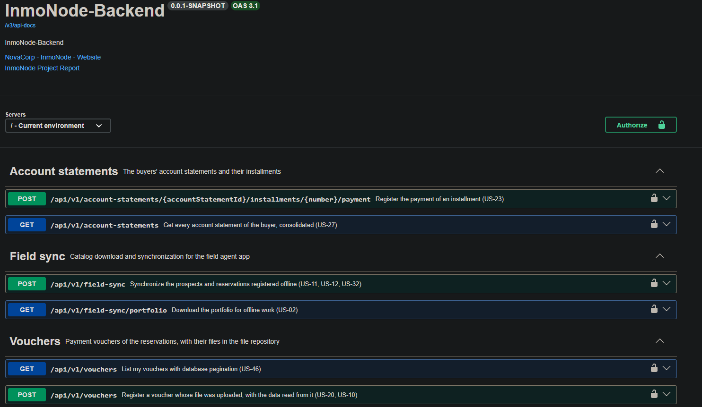
</p>

`POST /api/v1/catalog/projects` con el ejemplo de request y la respuesta 201 documentada.

<a id="figura-4-12"></a>

**Figura 4.12**

*Contrato de alta de proyecto (US-51)*

<p align="center">
  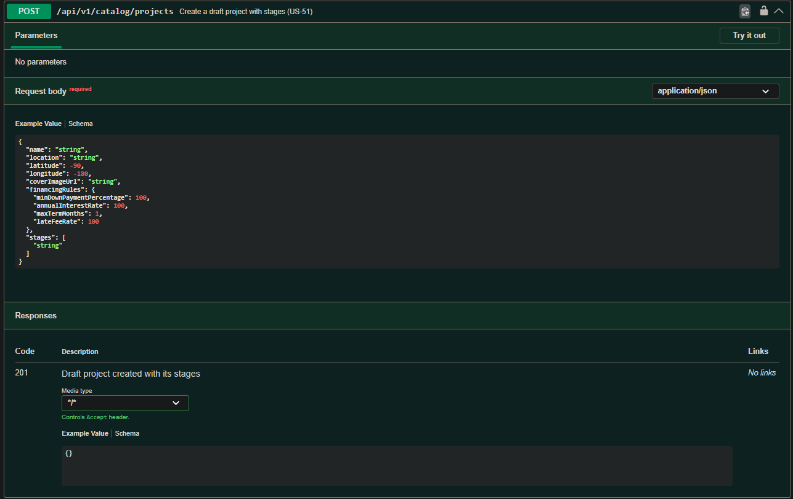
</p>

`POST /api/v1/catalog/projects/{projectId}/lots` con los parámetros, los campos de ficha técnica y polígono, y la respuesta 201 documentada.

<a id="figura-4-13"></a>

**Figura 4.13**

*Contrato de alta de lote (US-52)*

<p align="center">
  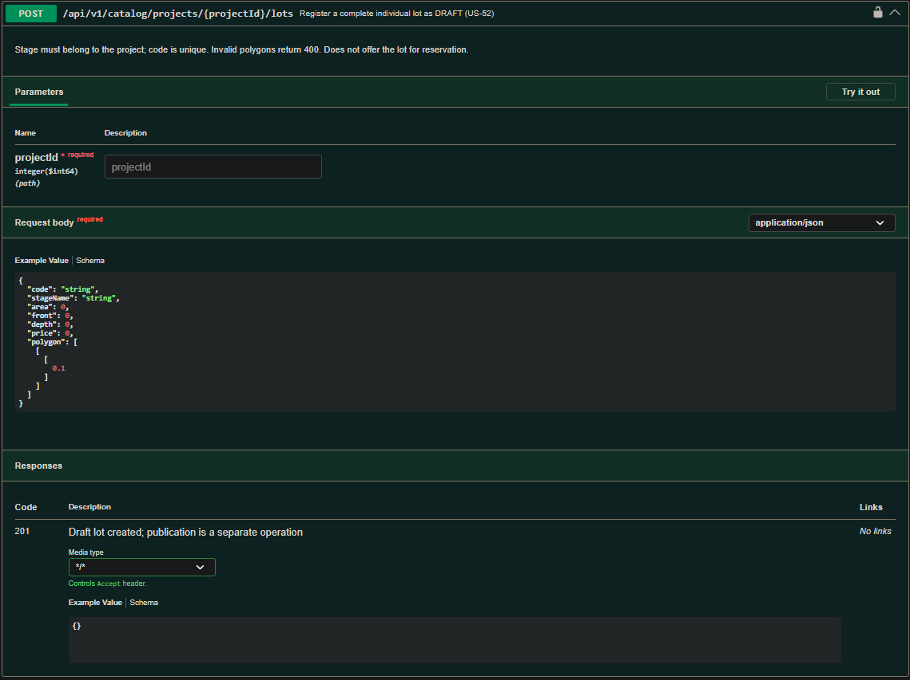
</p>

`PUT /api/v1/catalog/projects/{projectId}/publish` con la respuesta 200 documentada.

<a id="figura-4-14"></a>

**Figura 4.14**

*Contrato de publicación de proyecto (prerrequisito de US-53)*

<p align="center">
  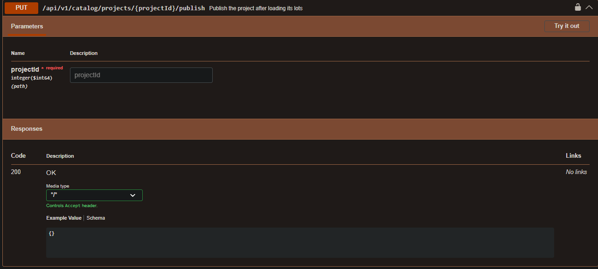
</p>

`PUT /api/v1/catalog/lots/{lotId}/publish` con la descripción de la transición a AVAILABLE.

<a id="figura-4-15"></a>

**Figura 4.15**

*Contrato de publicación de lote (US-53)*

<p align="center">
  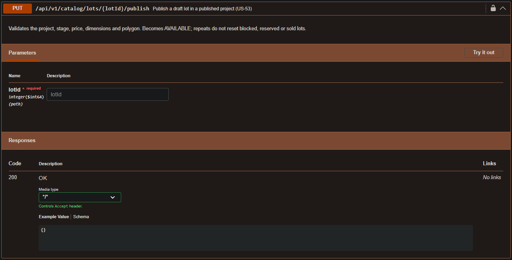
</p>

`GET /api/v1/projects` con el esquema de `priceRange`, `totalLots`, `availabilityPercentage` y `soldOut`.

<a id="figura-4-16"></a>

**Figura 4.16**

*Contrato del catálogo público (US-15)*

<p align="center">
  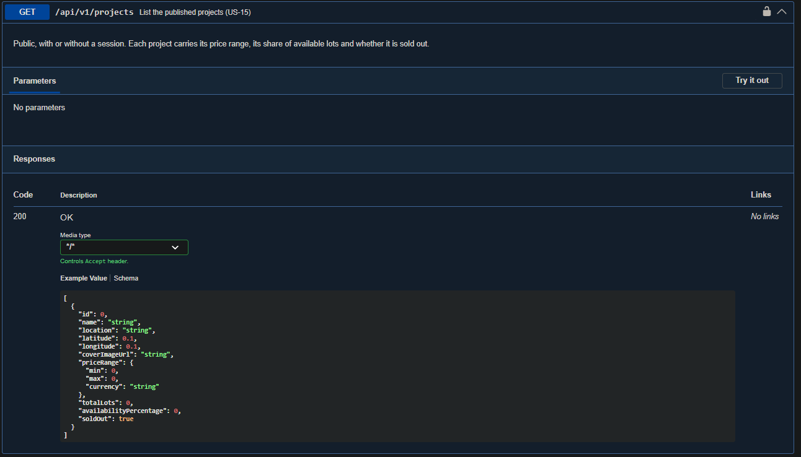
</p>

`GET /api/v1/projects/{projectId}/lots` con los filtros de área, precio, estado y viewport.

<a id="figura-4-17"></a>

**Figura 4.17**

*Contrato de consulta de lotes y filtros (US-52, US-15)*

<p align="center">
  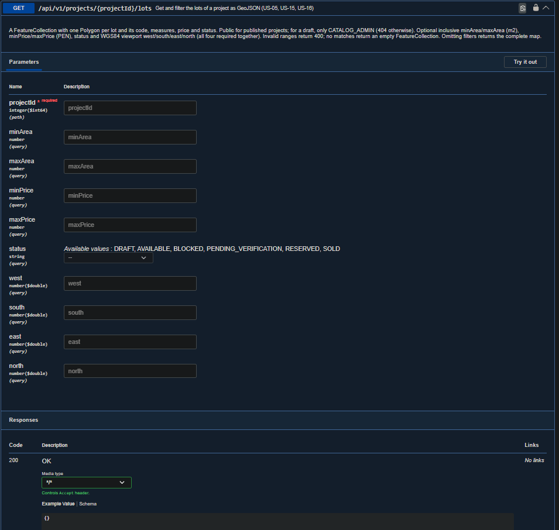
</p>

`GET /health` con las respuestas 200 y 503 documentadas.

<a id="figura-4-18"></a>

**Figura 4.18**

*Contrato de disponibilidad del servicio*

<p align="center">
  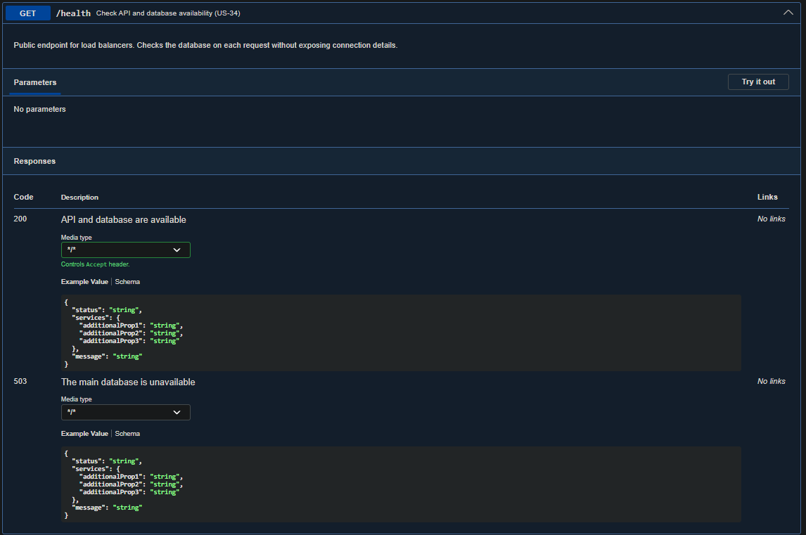
</p>

Ejemplo de request del alta de proyecto y su respuesta documentada.

<a id="figura-4-19"></a>

**Figura 4.19**

*Ejemplo de request del alta de proyecto (US-51)*

<p align="center">
  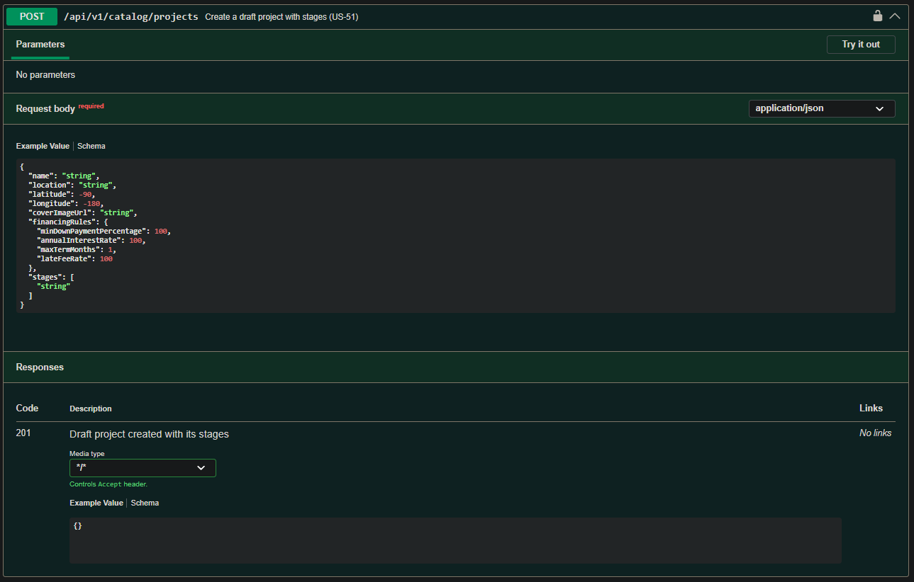
</p>

Ejemplo de alta de lote y descripción del rechazo 400 ante polígonos inválidos.

<a id="figura-4-20"></a>

**Figura 4.20**

*Validación de la geometría del lote (US-52)*

<p align="center">
  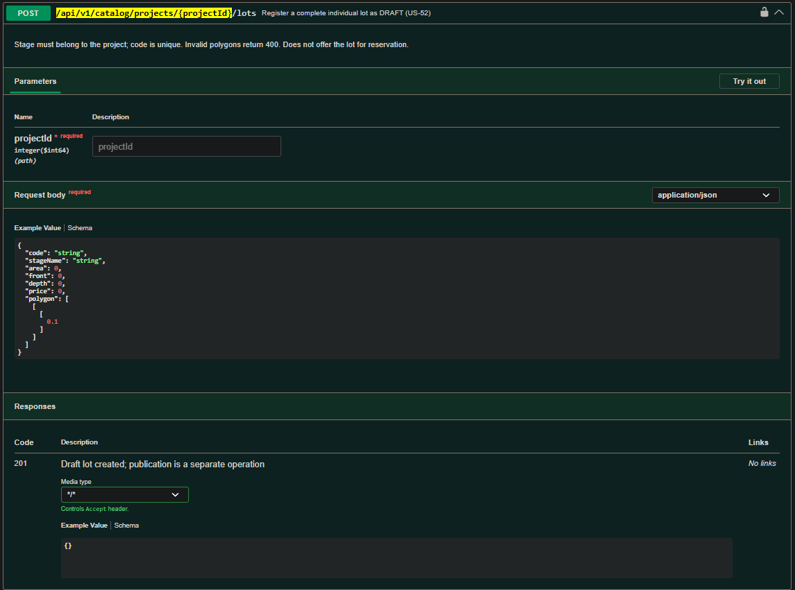
</p>

Respuestas documentadas de la publicación de un lote.

<a id="figura-4-21"></a>

**Figura 4.21**

*Respuestas documentadas de la publicación de lote (US-53)*

<p align="center">
  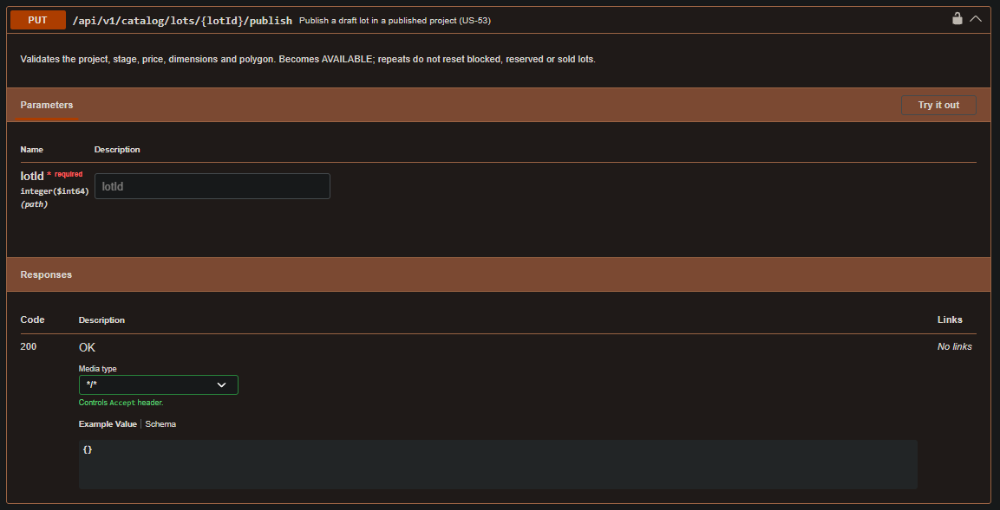
</p>

`GET /api/v1/catalog/projects/{projectId}/lots` marcado con el candado de seguridad `bearerAuth` y su respuesta 200 documentada.

<a id="figura-4-22"></a>

**Figura 4.22**

*Contrato de consulta administrativa protegida (US-51, US-52, US-53)*

<p align="center">
  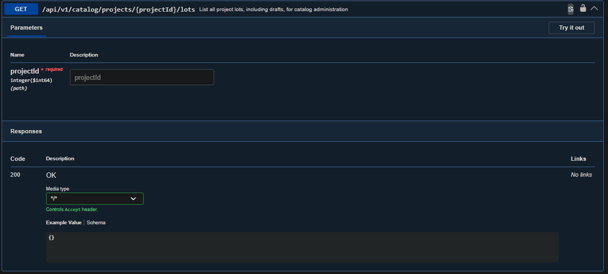
</p>

`POST /api/v1/field-sync` con ejemplos de `prospects` y `reservations` y la respuesta 201 documentada.

<a id="figura-4-23"></a>

**Figura 4.23**

*Contrato de recepción de registros de campo (soporte de US-04)*

<p align="center">
  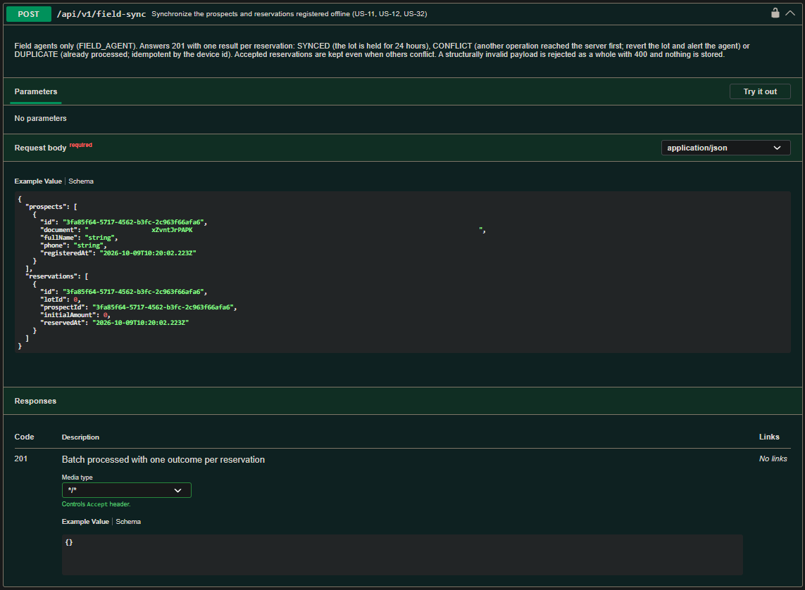
</p>

`GET /api/v1/field-sync/portfolio` con el ejemplo de proyectos, reglas y lotes; la descripción documenta el uso de ETag y la respuesta condicional 304.

<a id="figura-4-24"></a>

**Figura 4.24**

*Contrato de descarga del portafolio (US-02)*

<p align="center">
  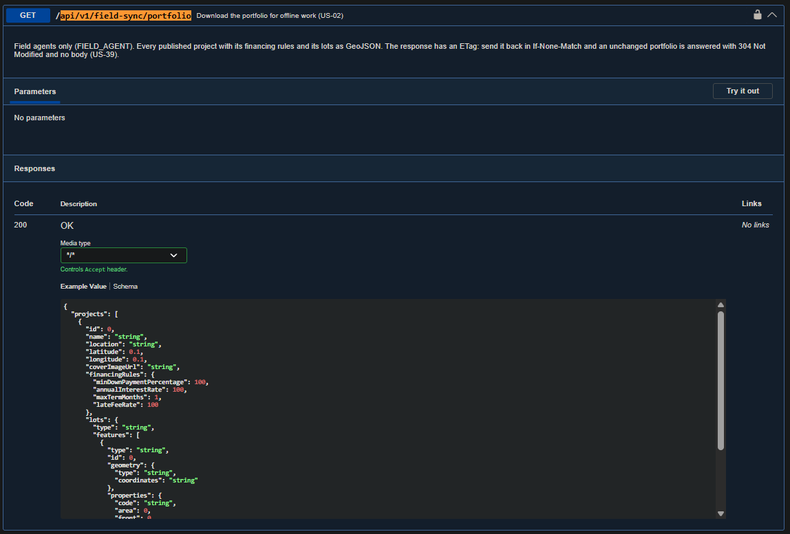
</p>

Ejecución real en el servicio desplegado: `GET https://inmonode-backend.onrender.com/api/v1/field-sync/portfolio` sin token devuelve 401 con `code=UNAUTHORIZED` y el mensaje *Authentication is required or the token is invalid or expired*, lo que evidencia la protección por token del endpoint.

<a id="figura-4-25"></a>

**Figura 4.25**

*Rechazo por falta de token en el servicio desplegado*

<p align="center">
  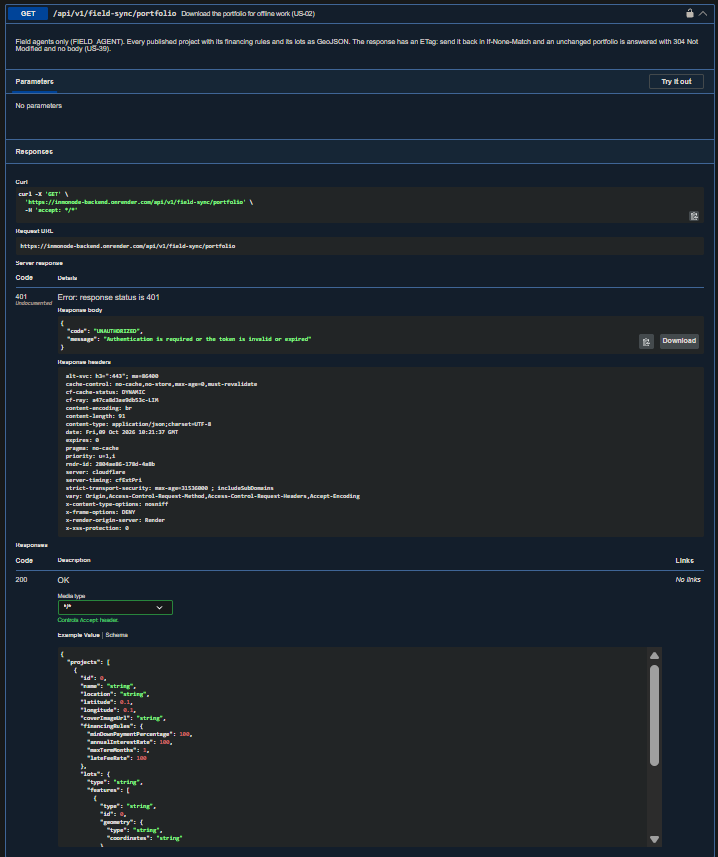
</p>

La [Tabla 4.15](#tabla-4-15) lista los commits relacionados con la documentación de los servicios.

<a id="tabla-4-15"></a>

**Tabla 4.15**

*Commits relacionados con la documentación de los Web Services*

| Repository | Commit Id | Documentation change |
|:---|:---|:---|
| [InmoNode-Backend](https://github.com/1ACC0238-2620-13981-NovaCorp-InmoNode/InmoNode-Backend) | [b3ce1f6](https://github.com/1ACC0238-2620-13981-NovaCorp-InmoNode/InmoNode-Backend/commit/b3ce1f6da2e2567b40324ebc67507b928e96f8d5) | Anotaciones del listado, el detalle y el plano publicado en ProjectsController y ProjectLotsController. |
| [InmoNode-Backend](https://github.com/1ACC0238-2620-13981-NovaCorp-InmoNode/InmoNode-Backend) | [211bdb0](https://github.com/1ACC0238-2620-13981-NovaCorp-InmoNode/InmoNode-Backend/commit/211bdb05868ec0685e9ef9e3e6f676f6127f9f81) | Contrato y anotaciones de la recepción de registros en FieldRecordsController. |
| [InmoNode-Backend](https://github.com/1ACC0238-2620-13981-NovaCorp-InmoNode/InmoNode-Backend) | [2b213d2](https://github.com/1ACC0238-2620-13981-NovaCorp-InmoNode/InmoNode-Backend/commit/2b213d2f77c90f2effdfc55846625cf0e1bd2ff4) | RealEstateCatalogController con las operaciones de US-51, US-52 y US-53, health, actualización de field-sync y filtros, y configuración de la documentación. |

##### 4.2.1.8. Software Deployment Evidence for Sprint Review

En el Sprint 1 el equipo publicó la Landing Page en GitHub Pages y desplegó los Web Services en Render. Para el backend se creó el Web Service Docker en Render conectado a la rama `main` del repositorio, se configuró Auto-Deploy On Commit y se verificó el endpoint `/health`; además se preparó la imagen Docker local y el workflow de CI en GitHub Actions. La [Tabla 4.16](#tabla-4-16) resume los pasos realizados.

<a id="tabla-4-16"></a>

**Tabla 4.16**

*Pasos de despliegue del Sprint 1*

| Producto | Paso | Proveedor y recurso | Configuración y automatización | Resultado verificado |
|:---|:---|:---|:---|:---|
| Landing Page | Publicar el sitio estático | GitHub Pages, repositorio InmoNode-Landing-Page | Versiones 1.0.0, 1.1.0 y 1.2.0 integradas mediante ramas `release/` el 2026-10-09 y el 2026-10-10. | Sitio público en [GitHub Pages](https://1acc0238-2620-13981-novacorp-inmonode.github.io/InmoNode-Landing-Page/). |
| Web Services | Construir la imagen local del backend | Docker Desktop (entorno local) | Imagen `inmonode-backend:0.0.1`, ID 20c1e8c55158, 622.72 MB. | Imagen disponible para pruebas locales (Figura 4.26). |
| Web Services | Configurar la integración continua | GitHub Actions, runner ubuntu-latest | `ci.yml` con Java 21, Maven verify, Docker/Testcontainers y artefactos de Surefire en cada pull request y push a `main` y `develop`, y ejecución manual. | Workflow versionado en el repositorio InmoNode-Backend. |
| Web Services | Publicar y verificar el backend | Render, Web Service Docker, plan Free, entorno Production | Rama `main`, commit cac4444, Auto-Deploy On Commit; Tomcat en el puerto 10000. | Deploy succeeded / Live el 2026-10-09 a las 04:47:24 (GMT-5) en 4 min 02 s; `GET /health` devuelve HTTP 200 con API y base de datos UP (figuras 4.27 a 4.31). |

Docker Desktop muestra la imagen `inmonode-backend:0.0.1` junto con las imágenes de soporte postgres:18, axllent/mailpit:v1.31.3, rustfs/rustfs:1.0.0, testcontainers/ryuk:0.14.0 y httpd:2.4-alpine.

<a id="figura-4-26"></a>

**Figura 4.26**

*Imagen local del backend en Docker Desktop*

<p align="center">
  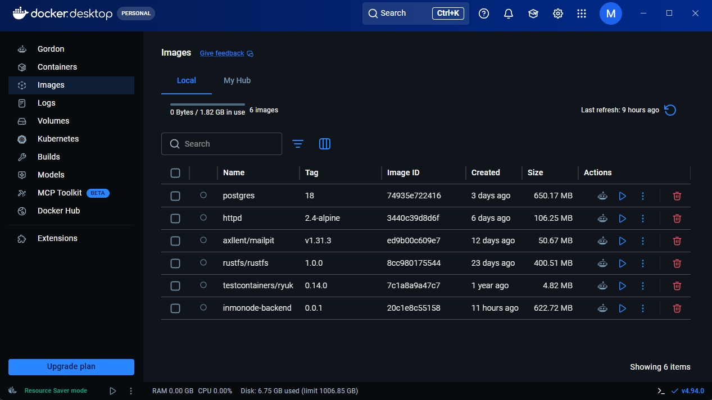
</p>

El panel de Render identifica InmoNode-Backend como Web Service Docker, plan Free, entorno Production, conectado al repositorio InmoNode-Backend, rama `main`, commit cac4444 y estado Live, con la URL pública [inmonode-backend.onrender.com](https://inmonode-backend.onrender.com). El historial incluye dos intentos fallidos y dos despliegues exitosos.

<a id="figura-4-27"></a>

**Figura 4.27**

*Servicio InmoNode-Backend publicado en Render*

<p align="center">
  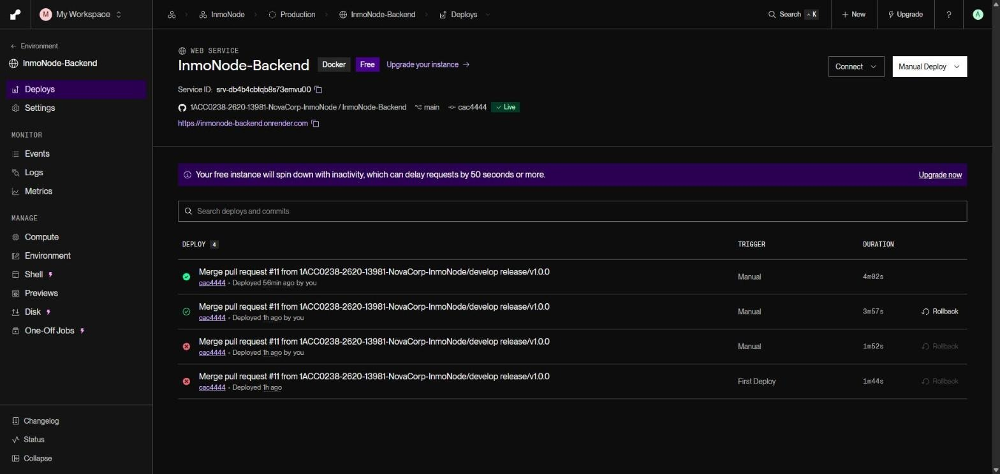
</p>

La configuración del servicio tiene Auto-Deploy On Commit, de modo que cada integración en `main` dispara un nuevo despliegue; el despliegue de la Figura 4.29 se disparó manualmente desde el Dashboard.

<a id="figura-4-28"></a>

**Figura 4.28**

*Configuración de Auto-Deploy en Render*

<p align="center">
  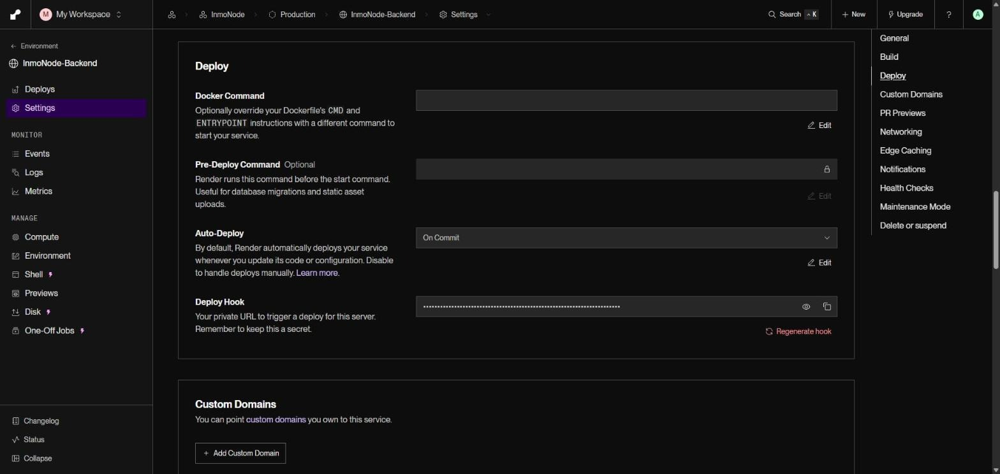
</p>

El despliegue del 2026-10-09 a las 04:47:24 (GMT-5) terminó en 4 min 02 s con estado Deploy succeeded / Live a partir del commit cac4444 (merge del pull request #11 de `develop`). Los logs muestran Tomcat iniciado en el puerto 10000, el arranque de InmoNodeBackendApplication y el mensaje *Your service is live*.

<a id="figura-4-29"></a>

**Figura 4.29**

*Despliegue exitoso y logs de arranque en Render*

<p align="center">
  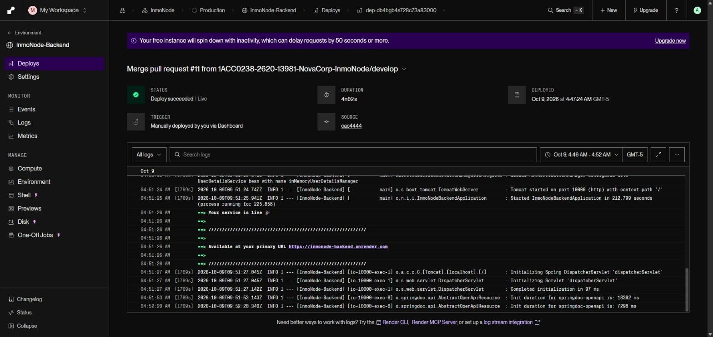
</p>

La vista Settings / Health Checks de Render permite configurar la ruta de comprobación automática del servicio; en la captura el campo Health Check Path aún no tiene valor, por lo que la comprobación de `/health` se realizó de forma manual (Figura 4.31).

<a id="figura-4-30"></a>

**Figura 4.30**

*Configuración de Health Checks en Render*

<p align="center">
  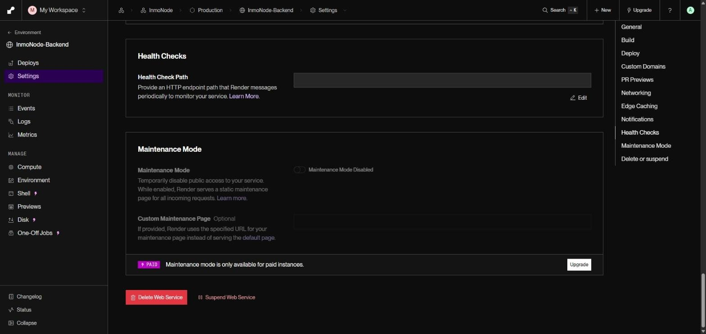
</p>

Swagger UI ejecuta `GET https://inmonode-backend.onrender.com/health` y recibe HTTP 200 con `status=UP`, `services.api=UP`, `services.database=UP` y el mensaje *All services are available*.

<a id="figura-4-31"></a>

**Figura 4.31**

*Disponibilidad del backend desplegado en Render*

<p align="center">
  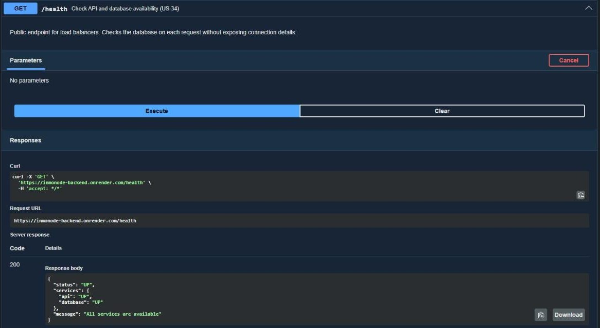
</p>

##### 4.2.1.9. Team Collaboration Insights during Sprint

La implementación del Sprint 1 se integró mediante ramas `feature/` y pull requests en cada repositorio. La [Tabla 4.17](#tabla-4-17) presenta los commits por integrante entre el 5 y el 9 de octubre de 2026 (GMT-5), excluyendo merges, en las revisiones indicadas.

<a id="tabla-4-17"></a>

**Tabla 4.17**

*Commits por integrante durante el Sprint 1*

| Repositorio y revisión | Integrante (autor Git) | Commits | Interpretación |
|:---|:---|:---:|:---|
| InmoNode-Backend, develop en 207b208 | Rocca Mariaca, Angel Mathias (AngelRocca) | 50 | Implementación de catálogo, prospectos y reservas en commits por funcionalidad; incluye soporte para historias de Sprints posteriores. |
| InmoNode-Backend, develop en 207b208 | Caisahuana Osores, Becker Junior (becker693) | 1 | Commit amplio con correcciones, pruebas, health y documentación OpenAPI. |
| InmoNode-Project-Report, feature/chapter-04 en 357f3ec | Caisahuana Osores, Becker Junior (becker693) | 6 | Estructura del capítulo IV, LACX y Sprint Backlog. |
| InmoNode-Project-Report, feature/chapter-04 en 357f3ec | Nuñez Soto, Andy Arturo (Arturo NS) | 1 | Configuración de la gestión del software y planificación inicial. |
| InmoNode-Project-Report, feature/chapter-04 en 357f3ec | Rocca Mariaca, Angel Mathias (AngelRocca) | 1 | Estructura inicial del capítulo IV. |

La implementación del backend se concentró en un integrante, mientras que la LACX asigna su liderazgo a Caisahuana Osores, Becker Junior. Como acción de mejora para el Sprint 2, las tareas de implementación se asignarán según la LACX y cada integrante trabajará en su propia rama `feature/`, de modo que el historial de cada repositorio refleje la participación de todo el equipo. La [Tabla 4.18](#tabla-4-18) resume las demás evidencias de colaboración.

<a id="tabla-4-18"></a>

**Tabla 4.18**

*Evidencias de colaboración del Sprint 1*

| Evidencia | Datos observados | Interpretación |
|:---|:---|:---|
| GitHub Pulse del backend (2 al 9 de octubre) | 11 pull requests fusionados, 0 abiertos, 2 autores y 52 commits excluyendo merges. | Integración continua de cambios mediante pull requests. |
| GitHub Pulse de la aplicación móvil (2 al 9 de octubre) | 5 pull requests fusionados, 2 autores y 202 commits excluyendo merges. | Desarrollo activo de la aplicación concentrado en dos autores. |
| GitHub Pulse de la Landing Page (3 al 10 de octubre) | 2 pull requests fusionados, 2 autores y 29 commits excluyendo merges. | Publicación de la Landing Page mediante ramas `feature/` y `release/`. |
| Tablero del Sprint 1 (2026-10-09) | 12 tareas en To Do y 11 en To Review. | Estado de las tareas al cierre de la captura. |

Las figuras 4.32 a 4.35 muestran los analíticos de colaboración de cada repositorio.

<a id="figura-4-32"></a>

**Figura 4.32**

*Actividad del repositorio InmoNode-Backend en GitHub Pulse*

<p align="center">
  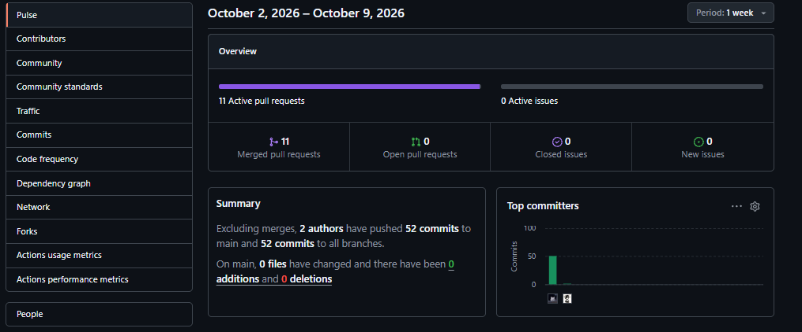
</p>

<a id="figura-4-33"></a>

**Figura 4.33**

*Actividad del repositorio InmoNode-Mobile en GitHub Pulse*

<p align="center">
  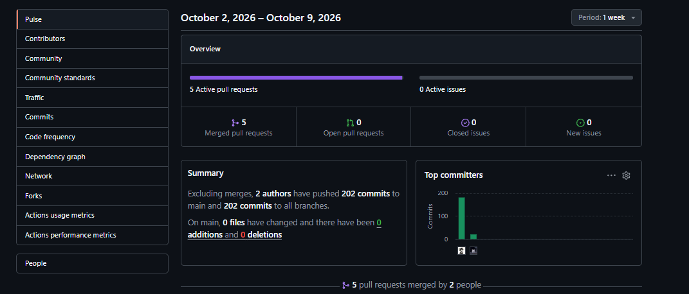
</p>

<a id="figura-4-34"></a>

**Figura 4.34**

*Contribuciones al repositorio InmoNode-Project-Report*

<p align="center">
  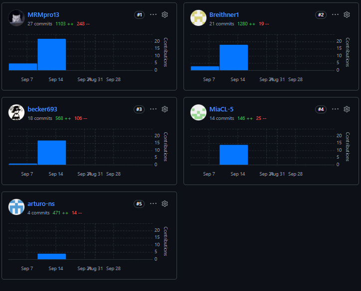
</p>

<a id="figura-4-35"></a>

**Figura 4.35**

*Actividad del repositorio InmoNode-Landing-Page en GitHub Pulse*

<p align="center">
  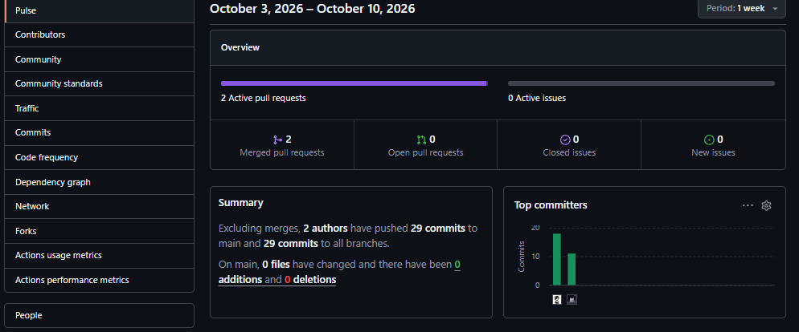
</p>

#### 4.2.2. Sprint 2

El Sprint 2 lleva a la aplicación Flutter de InmoNode, para Android y Web, el autoservicio del comprador e inversionista y el back-office del catálogo: registro de cuenta, exploración de proyectos, simulación de financiamiento y alta y publicación de proyectos y lotes. Su valor es que el comprador evalúe una compra sin contactar a un agente y que el back-office administre la oferta desde una interfaz gráfica, sobre los Web Services ya desplegados en Render.

##### 4.2.2.1. Sprint Planning 2

En el Sprint Planning 2 el equipo seleccionó del Product Backlog ([Tabla 2.60](Chapter-02.md#tabla-2-60)) seis historias que suman 23 Story Points: US-51, US-52, US-53, US-15, US-17 y US-14. El Sprint se desarrolla en el repositorio [InmoNode-Flutter](https://github.com/1ACC0238-2620-13981-NovaCorp-InmoNode/InmoNode-Flutter), que consume los Web Services desplegados en `https://inmonode-backend.onrender.com/api/v1`. US-51, US-52, US-53 y US-15 continúan desde el Sprint 1: sus Web Services se entregaron, pero los formularios del back-office y las tarjetas del catálogo quedaron en To Do ([Tabla 4.8](#tabla-4-8)). US-14 y US-17 se incorporan porque el registro de cuenta habilita el acceso del comprador y los Web Services ya exponen el registro, la verificación de correo, el inicio de sesión y la simulación de financiamiento. Como el curso comprende tres Sprints, las historias de campo de la aplicación Android, de US-03 a US-13 salvo US-04, se agrupan en el Sprint 3, que integrará y validará el código que el repositorio [InmoNode-Mobile](https://github.com/1ACC0238-2620-13981-NovaCorp-InmoNode/InmoNode-Mobile) ya contiene para ellas. La [Tabla 4.19](#tabla-4-19) resume la reunión.

<a id="tabla-4-19"></a>

**Tabla 4.19**

*Resumen del Sprint Planning 2*

| Campo | Contenido |
|:---|:---|
| **Sprint #** | Sprint 2 |
| **Sprint Planning Background** | |
| Date | 2026-11-09 |
| Time | 08:00 PM |
| Location | Reunión virtual |
| Prepared By | Perez Encarnacion, Breithner Rodolfo |
| Attendees (to planning meeting) | Caisahuana Osores, Becker Junior / Capillo Lema, Mía Valentina / Nuñez Soto, Andy Arturo / Rocca Mariaca, Angel Mathias |
| Sprint 1 Review Summary | Se presentaron los Web Services del catálogo, que permiten dar de alta proyectos con etapas, registrar lotes con polígono catastral, publicarlos y consultarlos en el catálogo público (US-51, US-52, US-53 y US-15). Están desplegados en Render, documentados con OpenAPI y verificados con 63 casos de prueba sin fallos. También se presentaron la Landing Page publicada en GitHub Pages (US-P01) y el registro offline de prospectos en Android (US-04), ejecutado en un dispositivo físico. El repositorio InmoNode-Mobile incorporó además, fuera del alcance del Sprint y sin validación en el dispositivo, el código del resto del flujo de campo: mapa catastral, separación offline, captura y OCR del voucher, cola de sincronización, resolución de conflictos y vista previa del contrato. Quedaron pendientes las interfaces del back-office y del catálogo (T01, T04, T07 y T13), la aceptación automatizada BDD (T19) y la suite de integración con Testcontainers. |
| Sprint 1 Retrospective Summary | La integración mediante ramas `feature/` y pull requests permitió publicar la Landing Page y los Web Services dentro del Sprint. Como aspectos por mejorar, la implementación del backend se concentró en un integrante (50 de 51 commits) y las tareas de interfaz web no se iniciaron. Para el Sprint 2 se acordó asignar las tareas según la LACX, trabajar cada historia en su propia rama `feature/US-<id>-<descripción>` y concentrar la interfaz del comprador y del back-office en una sola aplicación Flutter. |
| **Sprint Goal & User Stories** | US-51, US-52, US-53, US-15, US-17 y US-14 |
| Sprint 2 Goal | *Our focus is on* bringing the buyer self-service and the catalog back-office to the InmoNode Flutter application for Android and Web, on top of the Web Services deployed on Render. *We believe it delivers* an account from which buyers and investors explore published projects and simulate the financing of a lot without contacting a sales agent, and a graphical interface for catalog administrators to register and publish projects and lots. *This will be confirmed when* a buyer creates and verifies an account, signs in, browses the published projects and obtains the payment schedule of an available lot, and a catalog administrator registers a project with its lots and publishes it so that it appears in the buyer catalog, both on Android and in Chrome against the deployed backend. |
| Sprint 2 Velocity | 23 Story Points |
| Sum of Story Points | 23 Story Points (3 + 5 + 2 + 3 + 5 + 5) |

##### 4.2.2.2. Aspect Leaders and Collaborators

La Leadership-and-Collaboration Matrix (LACX) del Sprint 2 considera cinco aspectos de la aplicación Flutter y de su entrega:
- la base de la aplicación, con la cuenta y la sesión del usuario (US-14);
- el autoservicio del comprador, con la exploración del catálogo y la simulación de financiamiento (US-15 y US-17);
- el back-office del catálogo, para el alta y la publicación de proyectos y lotes (US-51, US-52 y US-53);
- el testing;
- el deployment.

Según lo acordado en la retrospectiva del Sprint 1, cada integrante lidera un aspecto y todos participan en la aplicación Flutter. La [Tabla 4.20](#tabla-4-20) indica el líder (L), que coordina contratos, revisión y entrega del aspecto, y los colaboradores (C).

<a id="tabla-4-20"></a>

**Tabla 4.20**

*Leadership-and-Collaboration Matrix del Sprint 2*

| Team Member | GitHub Username | Flutter App Base & IAM | Buyer Self-Service | Catalog Back-office | Testing | Deployment |
|:---|:---|:---:|:---:|:---:|:---:|:---:|
| Caisahuana Osores, Becker Junior | becker693 | C | L | C | C | C |
| Capillo Lema, Mía Valentina | MiaCL-5 | C | C | C | L | C |
| Nuñez Soto, Andy Arturo | arturo-ns | C | C | C | C | L |
| Perez Encarnacion, Breithner Rodolfo | Breithner1 | C | C | L | C | C |
| Rocca Mariaca, Angel Mathias | MRMpro13 | L | C | C | C | C |

Las tareas del Sprint Backlog ([Tabla 4.21](#tabla-4-21)) se asignan según esta matriz. El líder de cada aspecto asume sus tareas principales, y los colaboradores figuran entre paréntesis en la columna Assigned To:
- **Angel Rocca** configura la base de la aplicación y el registro, la verificación, el inicio de sesión y la navegación por rol (T24 a T27).
- **Becker Caisahuana** integra el catálogo publicado y la simulación de financiamiento con los Web Services (T29, T30 y T32). Además, conserva las tareas de los Web Services que consume el Sprint: la suite de integración con Testcontainers (T43) y la documentación OpenAPI (T44).
- **Breithner Perez** construye los formularios del back-office del catálogo (T35, T37, T38 y T40).
- **Mía Capillo** conduce las pruebas de cada historia y la aceptación automatizada BDD (T28, T31, T34, T36, T39 y T42).
- **Andy Nuñez** construye el simulador y el cronograma de cuotas (T33), valida la publicación en el catálogo del comprador (T41) y entrega la aplicación en Vercel y como APK (T45 y T46).

La carga resultante es de 24 horas para Angel Rocca, 26 para Becker Caisahuana y Breithner Perez, 28 para Mía Capillo y 22 para Andy Nuñez, con un total de 126 horas.

##### 4.2.2.3. Sprint Backlog 2

El objetivo del Sprint 2 es llevar a la aplicación Flutter el autoservicio del comprador e inversionista, con el registro de cuenta, la exploración del catálogo y la simulación de financiamiento, y el back-office del catálogo, con el alta y la publicación de proyectos y lotes. El Sprint Backlog descompone las seis historias en 23 tareas, numeradas de T24 a T46 a continuación de las del Sprint 1 y estimadas entre 4 y 8 horas, con un total de 126 horas. Las tareas de interfaz de US-51, US-52, US-53 y US-15 reemplazan a T01, T04, T07 y T13 del Sprint 1, que quedaron en To Do, y T42 continúa la aceptación automatizada BDD de T19. Según lo acordado en la retrospectiva, la carga se reparte entre 22 y 28 horas por integrante y todos participan en la aplicación Flutter.

El tablero está disponible en [Trello: NovaCorp-InmoNode Sprint 2](https://trello.com/b/ypAZHG4h/novacorp-inmonode-sprint-2) y la [Figura 4.36](#figura-4-36) muestra su estado al cierre del Sprint, el 2026-11-12.

<a id="figura-4-36"></a>

**Figura 4.36**

*Tablero del Sprint 2 en Trello al 2026-11-12*

<p align="center">
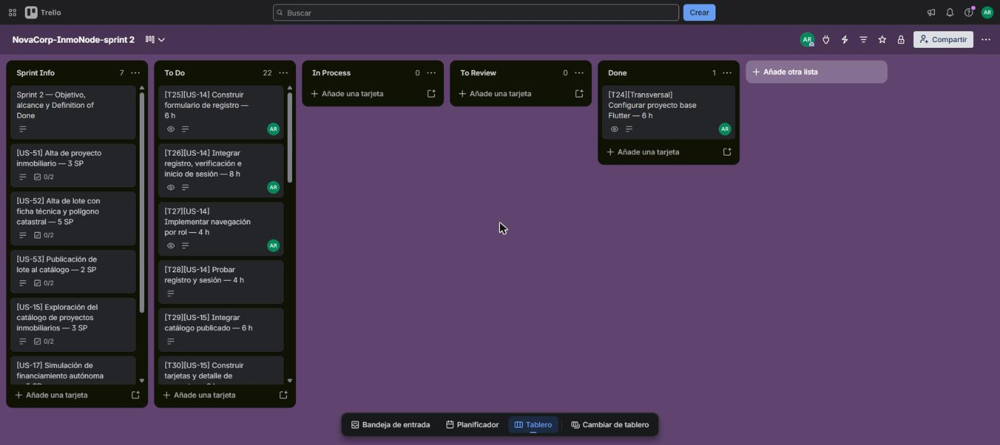
</p>

El tablero contiene el objetivo y la Definition of Done, las seis historias con sus criterios de aceptación y las 23 tareas con su descripción, estimación y responsable. A la fecha de la captura las 23 tareas se encuentran en Done, y la tarjeta del objetivo y las seis historias están marcadas como completas, cada historia con sus dos criterios de aceptación cumplidos (2/2). La [Tabla 4.21](#tabla-4-21) presenta el estado de cada tarea.

<a id="tabla-4-21"></a>

**Tabla 4.21**

*Sprint Backlog 2*

| User Story | Work-Item / Task | Description | Estimation (Hours) | Assigned To | Status |
|:---|:---|:---|:---:|:---|:---|
| **Sprint #** | **Sprint 2** | | | | |
| Transversal: Flutter App | T24 Configurar proyecto base Flutter | Crear el proyecto para Android y Web, la estructura de features por bounded context, el tema InmoNode, la inyección de dependencias con get_it y la URL base de los Web Services. | 6 | Angel Rocca | Done |
| US-14 Registro de cuenta de usuario web | T25 Construir formulario de registro | Capturar correo y contraseña de al menos 8 caracteres; validar los campos y, ante un correo ya registrado, mostrar el rechazo con el acceso a la recuperación de contraseña. | 6 | Angel Rocca | Done |
| US-14 Registro de cuenta de usuario web | T26 Integrar registro, verificación e inicio de sesión | Consumir POST /auth/register, /auth/verify-email y /auth/login; leer el token de la ruta /verify-email en Web y conservar el JWT y el refresh token de la sesión. | 8 | Angel Rocca (colabora Becker Caisahuana) | Done |
| US-14 Registro de cuenta de usuario web | T27 Implementar navegación por rol | Dirigir el rol BUYER a Proyectos y Simulador y el rol CATALOG_ADMIN al Catálogo del back-office; cerrar sesión con POST /auth/logout. | 4 | Angel Rocca (colabora Breithner Perez) | Done |
| US-14 Registro de cuenta de usuario web | T28 Probar registro y sesión | Probar los casos de uso y el ViewModel con flutter_test; validar la cuenta en estado Inactivo, el rechazo de correo duplicado y la activación con el enlace. | 4 | Mía Capillo (colabora Angel Rocca) | Done |
| US-15 Exploración del catálogo de proyectos inmobiliarios | T29 Integrar catálogo publicado | Implementar Project, Lot y ProjectRepository; consumir GET /projects, /projects/{projectId} y /projects/{projectId}/lots con sus DTOs y mappers. | 6 | Becker Caisahuana | Done |
| US-15 Exploración del catálogo de proyectos inmobiliarios | T30 Construir tarjetas y detalle de proyecto | Mostrar miniatura, rango de precios y porcentaje de disponibilidad; mantener visibles los proyectos vendidos con la etiqueta Vendido Totalmente (Sold Out). | 6 | Becker Caisahuana (colabora Breithner Perez) | Done |
| US-15 Exploración del catálogo de proyectos inmobiliarios | T31 Validar exploración del catálogo | Probar las tarjetas con y sin stock mediante pruebas de widgets y validar el catálogo contra los Web Services desplegados en Android y Chrome. | 4 | Mía Capillo (colabora Becker Caisahuana) | Done |
| US-17 Simulación de financiamiento autónoma | T32 Integrar simulación de financiamiento | Implementar Quotation e Installment; consumir POST /lots/{lotId}/quotations con el rol BUYER y presentar las respuestas 400 VALIDATION_ERROR, con la cuota inicial mínima, y 409 LOT_CONFLICT. | 6 | Becker Caisahuana (colabora Andy Nuñez) | Done |
| US-17 Simulación de financiamiento autónoma | T33 Construir simulador y cronograma | Capturar cuota inicial y plazo desde el lote; mostrar cuota mensual, tasa anual, intereses, total a pagar, vigencia y el cronograma de cuotas. | 8 | Andy Nuñez (colabora Angel Rocca) | Done |
| US-17 Simulación de financiamiento autónoma | T34 Validar simulación y cuota inicial mínima | Probar el ViewModel del simulador; validar el cronograma con la tasa del proyecto y el rechazo de una cuota inicial inferior al mínimo. | 4 | Mía Capillo (colabora Andy Nuñez) | Done |
| US-51 Alta de proyecto inmobiliario | T35 Construir formulario de alta de proyecto | Capturar nombre, ubicación y etapas; consumir POST /catalog/projects, señalar el campo faltante y mostrar el proyecto creado en Borrador. | 6 | Breithner Perez | Done |
| US-51 Alta de proyecto inmobiliario | T36 Validar alta y rechazo de proyecto | Probar el formulario y su ViewModel; validar el alta en DRAFT y el rechazo cuando se omite la ubicación. | 4 | Mía Capillo (colabora Breithner Perez) | Done |
| US-52 Alta de lote con ficha técnica y polígono catastral | T37 Construir formulario de ficha técnica | Capturar código, etapa, área, frente, fondo y precio base; consumir POST y GET /catalog/projects/{projectId}/lots y listar los lotes del proyecto. | 6 | Breithner Perez | Done |
| US-52 Alta de lote con ficha técnica y polígono catastral | T38 Capturar polígono catastral | Registrar los vértices del polígono, verificar que la figura esté cerrada y mostrar los errores de geometría que devuelven los Web Services. | 8 | Breithner Perez (colabora Becker Caisahuana) | Done |
| US-52 Alta de lote con ficha técnica y polígono catastral | T39 Validar registro de lote | Probar la ficha y el polígono; validar el lote No publicado y el rechazo de un polígono inválido, de un código duplicado y de una etapa ajena. | 4 | Mía Capillo (colabora Breithner Perez) | Done |
| US-53 Publicación de lote al catálogo | T40 Construir flujo de publicación | Confirmar la publicación del proyecto y de cada lote con PUT /catalog/projects/{projectId}/publish y /catalog/lots/{lotId}/publish; indicar el dato faltante. | 6 | Breithner Perez | Done |
| US-53 Publicación de lote al catálogo | T41 Validar publicación en el catálogo del comprador | Comprobar en Android y Chrome que el lote publicado aparece como disponible en el catálogo (US-15) y que un lote incompleto no se publica. | 4 | Andy Nuñez (colabora Breithner Perez) | Done |
| Transversal: Testing | T42 Completar aceptación automatizada BDD | Implementar los archivos .feature, los Steps y el runner de las seis historias, continuando T19; ejecutar y adjuntar resultados. | 8 | Mía Capillo (colabora el equipo) | Done |
| Transversal: Testing | T43 Ejecutar suite de integración con Testcontainers | Ejecutar en CI las pruebas de integración de los Web Services que consume el Sprint con PostgreSQL en Testcontainers y registrar los resultados. | 4 | Becker Caisahuana (colabora Mía Capillo) | Done |
| Transversal: Documentation | T44 Revisar y capturar OpenAPI de IAM y cotizaciones | Verificar esquemas, roles y respuestas de /auth y /lots/{lotId}/quotations; capturar Swagger. | 4 | Becker Caisahuana | Done |
| Transversal: Deployment | T45 Publicar Flutter Web en Vercel | Desplegar build/web; registrar su origen en CORS_ALLOWED_ORIGINS y su ruta /verify-email en VERIFICATION_URL de Render; comprobar el acceso público. | 6 | Andy Nuñez (colabora Becker Caisahuana) | Done |
| Transversal: Deployment | T46 Distribuir APK y demostrar flujos | Generar el APK con flutter build apk, distribuirlo con Firebase App Distribution, registrar versión y dispositivo y demostrar los flujos del comprador y del back-office. | 4 | Andy Nuñez (colabora Angel Rocca) | Done |

##### 4.2.2.4. Development Evidence for Sprint Review

##### 4.2.2.5. Testing Suite Evidence for Sprint Review

En el Sprint 2 las pruebas automatizadas cubren dos niveles: la aplicación Flutter y los Web Services que esta consume.

**Aplicación Flutter.** En [InmoNode-Flutter](https://github.com/1ACC0238-2620-13981-NovaCorp-InmoNode/InmoNode-Flutter/tree/d7648a31b10fa2a124972d96a25f6c657e73364a/test) se ejecutaron con Flutter 3.47.9 **196 pruebas sin fallos**:
- **182 pruebas unitarias y de widgets** con flutter_test. Reemplazan los Web Services con dobles escritos a mano y con el `MockClient` del paquete `http`.
- **14 casos de aceptación BDD (T42)**, escritos en Gherkin a partir de los criterios de aceptación de las seis historias. Los ejecuta el runner que genera bdd_widget_test. Cada escenario conduce la aplicación real, con sus pantallas, ViewModels y casos de uso, sobre Web Services en memoria.

El workflow `Flutter CI` de GitHub Actions corre en cada pull request: ejecuta el análisis estático y las pruebas unitarias y de aceptación, publica la tabla de escenarios en el resumen del job y adjunta los resultados como el artefacto `acceptance-results`. Su ejecución sobre el pull request [#6](https://github.com/1ACC0238-2620-13981-NovaCorp-InmoNode/InmoNode-Flutter/actions/runs/43291773080) terminó sin fallos.

**Web Services.** En el backend (T43), el workflow `Backend CI` ejecuta la suite completa con PostgreSQL 18 en Testcontainers, que en el Sprint 1 no pudo ejecutarse por falta de Docker. Sobre `main`, la [ejecución 43293803355](https://github.com/1ACC0238-2620-13981-NovaCorp-InmoNode/InmoNode-Backend/actions/runs/43293803355) dio 442 pruebas sin fallos.

El back-office del catálogo (`/api/v1/catalog/**`) solo tenía una prueba de controlador sin base de datos (TS13). Por eso se agregó `CatalogAdministrationIntegrationTest`, con 12 casos contra PostgreSQL. La [ejecución sobre el pull request #17](https://github.com/1ACC0238-2620-13981-NovaCorp-InmoNode/InmoNode-Backend/actions/runs/43296002293) terminó con **454 pruebas: sin fallos ni errores y con 3 omitidas**. Las omitidas son las de `LocalPostgresFlowIntegrationTest` (TS08), que solo corren contra la base local de validación del Sprint 1. De esas pruebas, 66 de integración cubren los Web Services que consume el Sprint.

La [Tabla 4.24](#tabla-4-24) relaciona cada grupo de pruebas con su historia, las clases o archivos y el comportamiento comprobado; la numeración continúa la de la [Tabla 4.11](#tabla-4-11).

<a id="tabla-4-24"></a>

**Tabla 4.24**

*Pruebas automatizadas del Sprint 2*

| Test Id | Type | User Story | Class and behavior | Test file | Result |
|:---|:---|:---|:---|:---|:---|
| TS14 | Unit | US-14 | Casos de uso de sesión: el inicio guarda la sesión, el cierre la limpia aunque falle la red y la restauración refresca un token vencido; el proveedor de tokens avisa cuando el refresh falla. | session_<wbr>use_<wbr>cases_<wbr>test.<wbr>dart, session_<wbr>token_<wbr>provider_<wbr>test.<wbr>dart | 12 + 6 casos aprobados. |
| TS15 | Unit | US-14 | AuthRepositoryImpl contra respuestas simuladas: cuenta Inactiva, 409 USER_CONFLICT, verificación y recuperación; claims del JWT; almacenamiento seguro de la sesión; AuthorizedClient agrega el Bearer y reintenta tras refrescar ante un 401. | auth_<wbr>repository_<wbr>impl_<wbr>test.<wbr>dart, jwt_<wbr>claims_<wbr>test.<wbr>dart, session_<wbr>repository_<wbr>impl_<wbr>test.<wbr>dart, authorized_<wbr>client_<wbr>test.<wbr>dart | 10 + 2 + 3 + 4 casos aprobados. |
| TS16 | Unit / Widget | US-14 | ViewModels de registro, verificación, inicio de sesión y recuperación; validación de correo y contraseña; lectura de los enlaces de correo; página de inicio de sesión. | auth_<wbr>view_<wbr>models_<wbr>test.<wbr>dart, auth_<wbr>validators_<wbr>test.<wbr>dart, email_<wbr>link_<wbr>test.<wbr>dart, login_<wbr>page_<wbr>test.<wbr>dart | 20 + 7 + 3 + 4 casos aprobados. |
| TS17 | Unit / Widget | US-15 | ProjectRepositoryImpl, ViewModels del catálogo, tarjetas con y sin stock (Vendido Totalmente), página de proyectos y formato de montos en soles. | project_<wbr>repository_<wbr>impl_<wbr>test.<wbr>dart, catalog_<wbr>view_<wbr>models_<wbr>test.<wbr>dart, project_<wbr>card_<wbr>test.<wbr>dart, projects_<wbr>page_<wbr>test.<wbr>dart, formats_<wbr>test.<wbr>dart | 5 + 6 + 4 + 7 + 6 casos aprobados. |
| TS18 | Unit / Widget | US-17 | Cuota inicial mínima del lote, QuotationRepositoryImpl con los rechazos del backend, ViewModels del simulador, panel de resultados y página del Simulador. | quotable_<wbr>lot_<wbr>test.<wbr>dart, quotation_<wbr>repository_<wbr>impl_<wbr>test.<wbr>dart, simulation_<wbr>view_<wbr>model_<wbr>test.<wbr>dart, simulator_<wbr>view_<wbr>model_<wbr>test.<wbr>dart, simulation_<wbr>panel_<wbr>test.<wbr>dart, simulator_<wbr>page_<wbr>test.<wbr>dart | 6 + 7 + 11 + 6 + 5 + 3 casos aprobados. |
| TS19 | Unit / Widget | US-51, US-52, US-53 | Polígono cerrado y sin cruces; casos de uso, repositorio con rechazos tipados, validación de campos, etiquetas en español, ViewModel y página del back-office. | lot_<wbr>boundary_<wbr>test.<wbr>dart, catalog_<wbr>admin_<wbr>use_<wbr>cases_<wbr>test.<wbr>dart, admin_<wbr>catalog_<wbr>repository_<wbr>impl_<wbr>test.<wbr>dart, admin_<wbr>catalog_<wbr>validators_<wbr>test.<wbr>dart, admin_<wbr>catalog_<wbr>labels_<wbr>test.<wbr>dart, admin_<wbr>catalog_<wbr>view_<wbr>model_<wbr>test.<wbr>dart, admin_<wbr>catalog_<wbr>page_<wbr>test.<wbr>dart | 4 + 3 + 7 + 10 + 4 + 7 + 10 casos aprobados. |
| TS20 | Acceptance (BDD) | US-14, US-15, US-17, US-51, US-52, US-53 | Doce escenarios Gherkin, que con los ejemplos de los Scenario Outline suman 14 casos, ejecutados sobre la aplicación real ([Tabla 4.25](#tabla-4-25)). | test/<wbr>acceptance/<wbr>us*.<wbr>feature | 14 casos aprobados. |
| TS21 | Integration | US-14 | Registro, verificación, inicio de sesión, rotación del refresh token, cierre de sesión, bloqueo y recuperación de contraseña por HTTP; reglas de acceso por rol y CORS; persistencia de los refresh tokens. | Auth<wbr>Controller<wbr>Integration<wbr>Test.<wbr>java, Web<wbr>Security<wbr>Configuration<wbr>Integration<wbr>Test.<wbr>java, Refresh<wbr>Token<wbr>Repository<wbr>Impl<wbr>Integration<wbr>Test.<wbr>java | 16 + 10 + 3 casos aprobados con PostgreSQL en Testcontainers. |
| TS22 | Integration | US-15 | Catálogo público con rango de precios y disponibilidad, proyectos vendidos visibles, borradores ocultos, lotes en GeoJSON y filtros; alta y publicación de proyectos e importación de lotes. | Project<wbr>Catalog<wbr>Integration<wbr>Test.<wbr>java, Projects<wbr>Controller<wbr>Integration<wbr>Test.<wbr>java, Project<wbr>Lots<wbr>Controller<wbr>Integration<wbr>Test.<wbr>java | 8 + 6 + 4 casos aprobados con PostgreSQL en Testcontainers. |
| TS23 | Integration | US-17 | Simulación con las reglas del proyecto, rechazo de la cuota inicial menor al mínimo y del plazo mayor al máximo, lotes no disponibles o de proyectos en borrador y acceso solo para BUYER. | Quotations<wbr>Integration<wbr>Test.<wbr>java | 7 casos aprobados con PostgreSQL en Testcontainers. |
| TS24 | Integration | US-51, US-52, US-53 | Alta de proyecto en DRAFT con sus etapas y rechazo sin ubicación; alta de lote en DRAFT y rechazo de polígono cruzado, código repetido, etapa ajena y proyecto inexistente; publicación del proyecto solo con lotes y del lote solo con su proyecto publicado; el lote publicado aparece como AVAILABLE en el catálogo del comprador; 403 para BUYER y 401 sin sesión. | Catalog<wbr>Administration<wbr>Integration<wbr>Test.<wbr>java | 12 casos aprobados con PostgreSQL en Testcontainers. |

La [Tabla 4.25](#tabla-4-25) presenta el resultado de cada escenario de aceptación, tomado del resumen de `Flutter CI` que muestra la [Figura 4.37](#figura-4-37). Los archivos `.feature` se encuentran en [test/acceptance](https://github.com/1ACC0238-2620-13981-NovaCorp-InmoNode/InmoNode-Flutter/tree/d7648a31b10fa2a124972d96a25f6c657e73364a/test/acceptance).

<a id="tabla-4-25"></a>

**Tabla 4.25**

*Resultados de los escenarios de aceptación del Sprint 2*

| User Story | Feature | Scenario | Cases | Result |
|:---|:---|:---|:---:|:---|
| US-14 | Web account registration | Account creation and validation | 1 | Passed |
| US-14 | Web account registration | Email already registered | 1 | Passed |
| US-15 | Real estate project catalog | Overview of the active projects | 1 | Passed |
| US-15 | Real estate project catalog | Sold-out project indicator | 1 | Passed |
| US-17 | Self-service financing simulation | Calculation with the standard rate | 1 | Passed |
| US-17 | Self-service financing simulation | Minimum down payment validation | 1 | Passed |
| US-51 | Real estate project registration | Project created successfully | 1 | Passed |
| US-51 | Real estate project registration | Registration rejected for missing data | 1 | Passed |
| US-52 | Lot registration with its technical sheet and cadastral polygon | Lot registered in an existing project | 1 | Passed |
| US-52 | Lot registration with its technical sheet and cadastral polygon | Invalid polygon rejected (polígono cruzado y polígono de dos vértices) | 2 | Passed |
| US-53 | Lot publication to the catalog | Successful publication | 1 | Passed |
| US-53 | Lot publication to the catalog | Publication blocked by missing data (sin precio y sin polígono) | 2 | Passed |

<a id="figura-4-37"></a>

**Figura 4.37**

*Resultados de aceptación BDD en Flutter CI*

<p align="center">
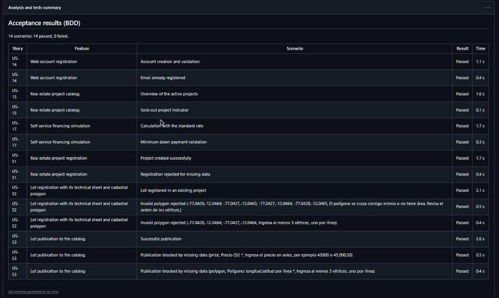
</p>

La [Figura 4.38](#figura-4-38) muestra el cierre de la ejecución de `Backend CI` sobre el pull request #17.

<a id="figura-4-38"></a>

**Figura 4.38**

*Suite del backend con Testcontainers en Backend CI*

<p align="center">
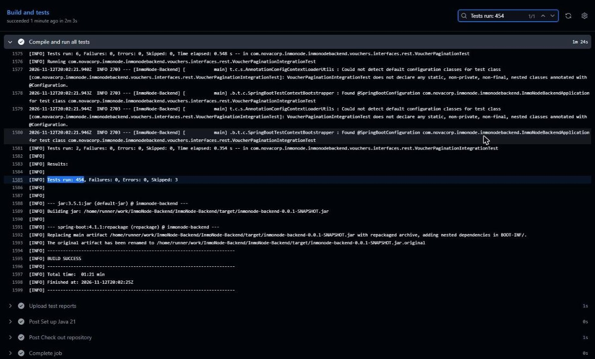
</p>

Las pruebas se reproducen con los siguientes comandos:

```powershell
# InmoNode-Flutter
flutter test --exclude-tags acceptance
flutter test --tags acceptance --file-reporter json:build/acceptance/results.json
dart run tool/acceptance_report.dart build/acceptance/results.json

# InmoNode-Backend: requiere Docker para Testcontainers
.\mvnw.cmd --batch-mode --no-transfer-progress '-Dtest=CatalogAdministrationIntegrationTest' test
.\mvnw.cmd --batch-mode --no-transfer-progress verify
```

La [Tabla 4.26](#tabla-4-26) lista los commits que incorporaron las pruebas.

<a id="tabla-4-26"></a>

**Tabla 4.26**

*Commits relacionados con pruebas en el Sprint 2*

| Repository | Branch | Commit Id | Commit Message | Commit Message Body | Committed on (Date) |
|:---|:---|:---|:---|:---|:---|
| Inmo<wbr>Node-<wbr>Flutter | feature/<wbr>US-14-<wbr>buyer-<wbr>account → develop | [632f0d2](https://github.com/1ACC0238-2620-13981-NovaCorp-InmoNode/InmoNode-Flutter/commit/632f0d2d7b7d5d30e0128441d09669e6875223ea) | test(iam): cover auth use cases, repository and view models | — (pruebas de TS14 a TS16) | 2026-11-11 |
| Inmo<wbr>Node-<wbr>Flutter | feature/<wbr>US-14-<wbr>buyer-<wbr>account → develop | [b5ed32a](https://github.com/1ACC0238-2620-13981-NovaCorp-InmoNode/InmoNode-Flutter/commit/b5ed32ae88c143df1e5efdd8e0c8296ed6cde556) | test(iam): cover the password recovery flow | — | 2026-11-11 |
| Inmo<wbr>Node-<wbr>Flutter | feature/<wbr>US-15-<wbr>project-<wbr>catalog → develop | [514699e](https://github.com/1ACC0238-2620-13981-NovaCorp-InmoNode/InmoNode-Flutter/commit/514699e557f57fddb5a35afa06cccd8056097f7c) | test(catalog): cover the catalog with and without stock | — (TS17, salvo formats_<wbr>test.<wbr>dart, que llegó con el commit [4c81a96](https://github.com/1ACC0238-2620-13981-NovaCorp-InmoNode/InmoNode-Flutter/commit/4c81a9608c7e5446de8f66867b627c0e960fdca4) del formato de montos) | 2026-11-11 |
| Inmo<wbr>Node-<wbr>Flutter | feature/<wbr>US-17-<wbr>financing-<wbr>simulation → develop | [bdecd56](https://github.com/1ACC0238-2620-13981-NovaCorp-InmoNode/InmoNode-Flutter/commit/bdecd56e32e30d9b6c0ff45b678e6901f8d56d69) | test(quotations): cover the simulator, the minimum down payment and the schedule | — (TS18) | 2026-11-11 |
| Inmo<wbr>Node-<wbr>Flutter | feature/<wbr>US-53-<wbr>lot-<wbr>publication → develop | [413a969](https://github.com/1ACC0238-2620-13981-NovaCorp-InmoNode/InmoNode-Flutter/commit/413a969b978777e482cb9436a9096faeb0da7a3a) | test(quotations): accept disposed notifier error across Flutter versions | — | 2026-11-11 |
| Inmo<wbr>Node-<wbr>Flutter | feature/<wbr>US-53-<wbr>lot-<wbr>publication → develop | [69ee0d6](https://github.com/1ACC0238-2620-13981-NovaCorp-InmoNode/InmoNode-Flutter/commit/69ee0d6820465b83ea72e22f87504a29f787f16f) | test(catalog_admin): cover the catalog page, its checks and its messages | — (pruebas de etiquetas y de página de TS19) | 2026-11-12 |
| Inmo<wbr>Node-<wbr>Flutter | feature/<wbr>US-53-<wbr>lot-<wbr>publication → develop | [3ee1735](https://github.com/1ACC0238-2620-13981-NovaCorp-InmoNode/InmoNode-Flutter/commit/3ee1735ab527895213546d6e81aeb23684d5f463) | refactor(catalog_admin): layer the back-office like the rest of the app | Separa el back-office en dominio, aplicación, infraestructura y presentación (agrega las pruebas de polígono, casos de uso, repositorio, validación y ViewModel de TS19) | 2026-11-12 |
| Inmo<wbr>Node-<wbr>Flutter | test/<wbr>T42-<wbr>bdd-<wbr>acceptance → develop | [cf12ead](https://github.com/1ACC0238-2620-13981-NovaCorp-InmoNode/InmoNode-Flutter/commit/cf12ead26d7731605f9da264ffe3c62c8b7d0eb5) | test(acceptance): add in-memory Web Services and drive the real app | — (soporte de TS20) | 2026-11-12 |
| Inmo<wbr>Node-<wbr>Flutter | test/<wbr>T42-<wbr>bdd-<wbr>acceptance → develop | [09ddc93](https://github.com/1ACC0238-2620-13981-NovaCorp-InmoNode/InmoNode-Flutter/commit/09ddc936cf9b00b515243770b0c4a3fddafc4ce1) | test(acceptance): automate the acceptance criteria of the Sprint 2 stories | — (TS20) | 2026-11-12 |
| Inmo<wbr>Node-<wbr>Flutter | test/<wbr>T42-<wbr>bdd-<wbr>acceptance → develop | [3115007](https://github.com/1ACC0238-2620-13981-NovaCorp-InmoNode/InmoNode-Flutter/commit/3115007362be79eb705a374701d9e5841f28bb4f) | ci: run analysis, unit and acceptance tests on pull requests | — (workflow Flutter CI) | 2026-11-12 |
| Inmo<wbr>Node-<wbr>Backend | test/<wbr>T43-<wbr>catalog-<wbr>administration-<wbr>integration → develop | [b3ded28](https://github.com/1ACC0238-2620-13981-NovaCorp-InmoNode/InmoNode-Backend/commit/b3ded28c7f6ce17308f0ab8cb084cba05933a352) | test(catalog): cover the catalog back-office web services against PostgreSQL | Registers projects with stages and their lots, rejects crossing polygons, repeated codes and foreign stages, enforces the publication order and checks that a published lot reaches the buyer catalog. (TS24) | 2026-11-12 |

Las pruebas de integración TS21 a TS23 ya formaban parte del backend; T43 las ejecutó en CI y agregó TS24. Los resultados de cada ejecución quedan como artefactos de GitHub Actions: `acceptance-results` en Flutter y `test-reports` en el backend.

##### 4.2.2.6. Execution Evidence for Sprint Review

##### 4.2.2.7. Services Documentation Evidence for Sprint Review

En el Sprint 2 la aplicación Flutter consume tres grupos de Web Services:
- los de identidad y acceso (`/api/v1/auth`), para registrar la cuenta e iniciar sesión (US-14);
- el de cotizaciones (`/api/v1/lots/{lotId}/quotations`), para simular el financiamiento (US-17);
- los del catálogo y el back-office, documentados en el Sprint 1 ([Tabla 4.14](#tabla-4-14)).

La documentación OpenAPI 3.1 se genera con springdoc-openapi 3.0.3 a partir de las anotaciones de los controladores y se publica en el Swagger UI del servicio desplegado: [inmonode-backend.onrender.com/swagger-ui/index.html](https://inmonode-backend.onrender.com/swagger-ui/index.html).

**Revisión del contrato (T44).** Se contrastó el documento que publicaba Render con la implementación y con las pruebas de integración de `/auth` y de cotizaciones. La revisión encontró estas diferencias:
- **Códigos de éxito:** el registro y la simulación documentaban 200, aunque responden 201.
- **Esquemas:** ninguna respuesta exponía su esquema. Swagger mostraba un `object` genérico en lugar de `UserResource`, `TokenResource` o `QuotationResource`.
- **Errores:** no se documentaban los códigos de error.
- **Acceso:** las operaciones públicas de `/auth` y las lecturas del catálogo (`GET /api/v1/projects/**`) aparecían con el candado de `bearerAuth`, como si exigieran token.
- **Restablecimiento:** el 204 de `reset-password` declaraba un cuerpo.
- **Historias:** la recuperación de contraseña aparecía etiquetada como US-52, que en este informe es el alta de lote.

Los pull requests [#18](https://github.com/1ACC0238-2620-13981-NovaCorp-InmoNode/InmoNode-Backend/pull/18) y [#19](https://github.com/1ACC0238-2620-13981-NovaCorp-InmoNode/InmoNode-Backend/pull/19) corrigen las anotaciones sin cambiar el comportamiento de los servicios:
- cada operación de `/auth` y de cotizaciones documenta su esquema de éxito y sus errores con `ErrorResource` (`code`, `message`, `details`);
- las operaciones de `/auth` y el listado de proyectos se declaran públicos;
- el detalle de un proyecto y sus lotes declaran el token como opcional, porque con el de CATALOG_ADMIN también devuelven los borradores;
- tres pruebas de integración leen `/v3/api-docs` y fallan si el contrato vuelve a desviarse.

La [Tabla 4.28](#tabla-4-28) presenta las acciones documentadas.

<a id="tabla-4-28"></a>

**Tabla 4.28**

*Endpoints de identidad y cotizaciones documentados con OpenAPI en el Sprint 2*

| Verbo | Endpoint | Acción implementada | Parámetros | Response y explicación |
|:---|:---|:---|:---|:---|
| POST | /<wbr>api/<wbr>v1/<wbr>auth/<wbr>register | Registrar cuenta de comprador (US-14) | Público; `email` válido y `password` de 8 a 72 caracteres (ejemplo A). | 201 con `id`, `email`, `role=BUYER` y `status=INACTIVE`, y envío del enlace de verificación. 400 VALIDATION_ERROR por datos inválidos; 409 USER_CONFLICT si el correo ya está registrado. |
| POST | /<wbr>api/<wbr>v1/<wbr>auth/<wbr>verify-<wbr>email | Activar la cuenta (US-14) | Público; `token` del enlace del correo. | 200 con la cuenta en `status=ACTIVE`. 400 VALIDATION_ERROR si el token no existe, venció o ya se usó. |
| POST | /<wbr>api/<wbr>v1/<wbr>auth/<wbr>resend-<wbr>verification | Reenviar el enlace de verificación (US-14) | Público; `email`. | 204 siempre, para no revelar si la cuenta existe. Solo una cuenta pendiente recibe el correo, con 60 s de espera entre envíos. |
| POST | /<wbr>api/<wbr>v1/<wbr>auth/<wbr>login | Iniciar sesión (US-14; también US-01 del agente de campo) | Público; `email` y `password` (ejemplo B). | 200 con `token` (JWT con el claim `role`), `tokenType`, `expiresIn` y `refreshToken`. 401 INVALID_CREDENTIALS; 403 ACCOUNT_INACTIVE si el correo no está verificado; 423 ACCOUNT_LOCKED tras el quinto intento fallido. |
| POST | /<wbr>api/<wbr>v1/<wbr>auth/<wbr>refresh | Renovar la sesión (US-14) | Público; `refreshToken`. | 200 con un nuevo par de tokens; el refresh token presentado deja de servir. 401 INVALID_REFRESH_TOKEN; reutilizar uno ya usado revoca todas las sesiones de la cuenta. |
| POST | /<wbr>api/<wbr>v1/<wbr>auth/<wbr>logout | Cerrar sesión (US-14) | Público; `refreshToken`. | 204 siempre, con el refresh token revocado. El JWT sigue vigente hasta vencer, por lo que el cliente lo descarta. |
| POST | /<wbr>api/<wbr>v1/<wbr>auth/<wbr>forgot-<wbr>password | Solicitar la recuperación de contraseña (US-14) | Público; `email`. | 204 siempre. Solo una cuenta activa recibe el enlace, que funciona una vez durante 30 minutos. |
| POST | /<wbr>api/<wbr>v1/<wbr>auth/<wbr>reset-<wbr>password | Restablecer la contraseña (US-14) | Público; `token` y `newPassword` de 8 a 72 caracteres. | 204 sin cuerpo; la cuenta se desbloquea y todas sus sesiones se cierran. 400 INVALID_RESET_TOKEN o VALIDATION_ERROR. |
| POST | /<wbr>api/<wbr>v1/<wbr>lots/<wbr>{lot<wbr>Id}/<wbr>quotations | Simular el financiamiento de un lote (US-17) | Token con rol BUYER; `lotId` en la ruta; `initialPayment` y `termMonths` (ejemplo C). | 201 con la cotización: monto financiado, tasa anual, cuota mensual, intereses, total, vigencia de 7 días y cronograma de cuotas por el sistema francés. 400 VALIDATION_ERROR si la cuota inicial es menor al mínimo o cubre todo el precio, o si el plazo supera el máximo; 401 sin token; 403 con otro rol; 404 LOT_NOT_FOUND; 409 LOT_CONFLICT si el lote no está disponible. |
| GET | /<wbr>api/<wbr>v1/<wbr>quotations/<wbr>{quotation<wbr>Id} | Consultar una cotización propia (soporte de US-17) | Token con rol BUYER; `quotationId` en la ruta. | 200 con la cotización y su cronograma. 404 QUOTATION_NOT_FOUND si no existe o pertenece a otro comprador. |

Los ejemplos A a C son requests de referencia para invocar los endpoints.

**A. Request de registro de cuenta (US-14):**

```json
{"email": "compradora@example.com", "password": "Pinos-2026"}
```

**B. Request de inicio de sesión.** La respuesta 200 trae `tokenType` `Bearer` y `expiresIn` 3600 segundos. El `token` se envía como `Authorization: Bearer <token>` y el `refreshToken` se guarda para `POST /api/v1/auth/refresh`:

```json
{"email": "compradora@example.com", "password": "Pinos-2026"}
```

**C. Request de simulación de financiamiento (US-17).** Para el lote N-01 de S/ 45,000 del proyecto de prueba en Render, con 10 % de cuota inicial mínima y 12.5 % de tasa anual, la respuesta 201 registró una cuota mensual de S/ 897.55 y un total de S/ 58,353.29 en 60 cuotas:

```json
{"initialPayment": 4500, "termMonths": 60}
```

**Capturas de la documentación en Swagger UI.** Las figuras 4.39 a 4.42 muestran el contrato corregido, tomado del Swagger UI de la rama `develop`, con los pull requests #18 y #19, ejecutada con Docker Compose. Ese mismo contrato está publicado en Render desde el 12 de noviembre de 2026, cuando el pull request [#20](https://github.com/1ACC0238-2620-13981-NovaCorp-InmoNode/InmoNode-Backend/pull/20) pasó `develop` a `main`.

Las operaciones de identidad y el listado de proyectos aparecen sin el candado de `bearerAuth`, que sí llevan las escrituras del catálogo. Swagger UI también lo muestra en el detalle y los lotes de un proyecto, porque aceptan un token opcional.

<a id="figura-4-39"></a>

**Figura 4.39**

*Acceso de las operaciones de identidad y del catálogo de proyectos*

<p align="center">
  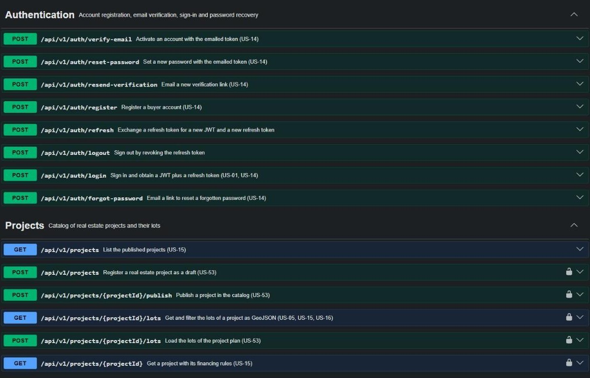
</p>

`POST /api/v1/auth/register` con el request y las respuestas 201, 400 y 409.

<a id="figura-4-40"></a>

**Figura 4.40**

*Contrato de registro de cuenta (US-14)*

<p align="center">
  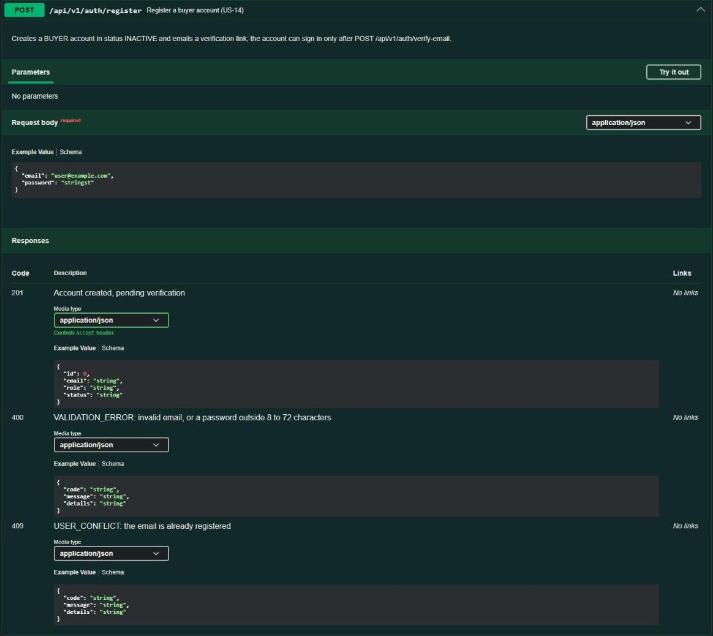
</p>

`POST /api/v1/auth/login` con el request y las respuestas 200, 400, 401, 403 y 423.

<a id="figura-4-41"></a>

**Figura 4.41**

*Contrato de inicio de sesión (US-14)*

<p align="center">
  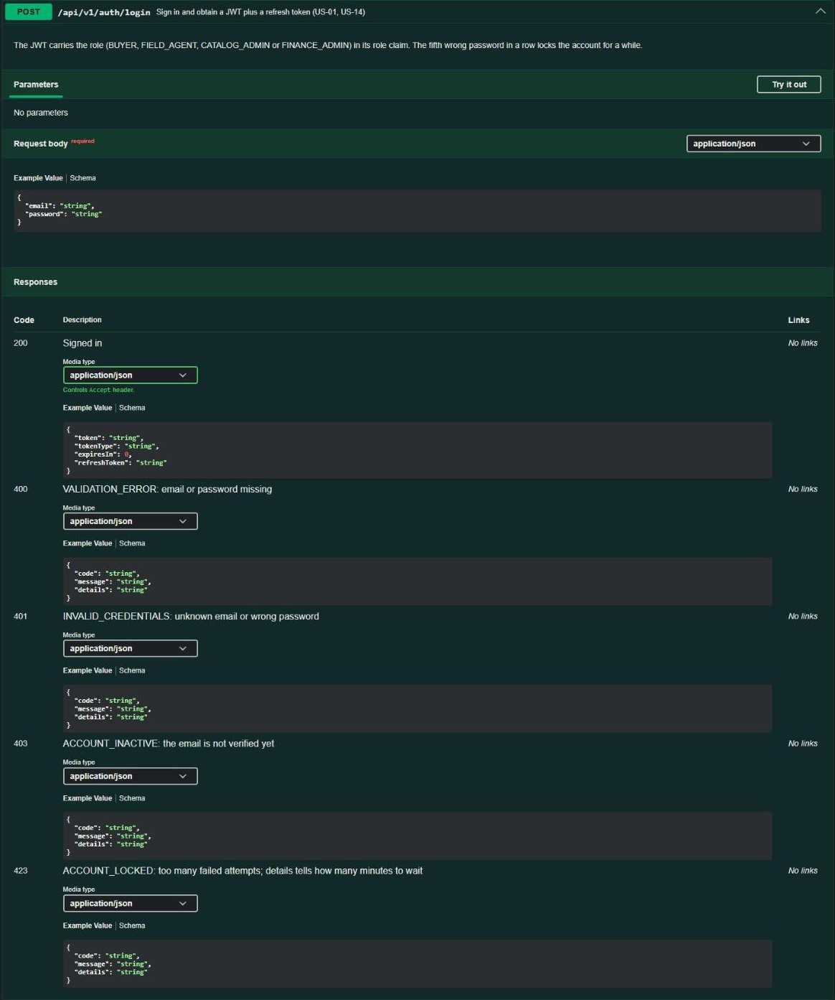
</p>

`POST /api/v1/lots/{lotId}/quotations`, protegido para BUYER, con el request, el esquema de la cotización y las respuestas 201, 400, 401, 403, 404 y 409.

<a id="figura-4-42"></a>

**Figura 4.42**

*Contrato de simulación de financiamiento (US-17)*

<p align="center">
  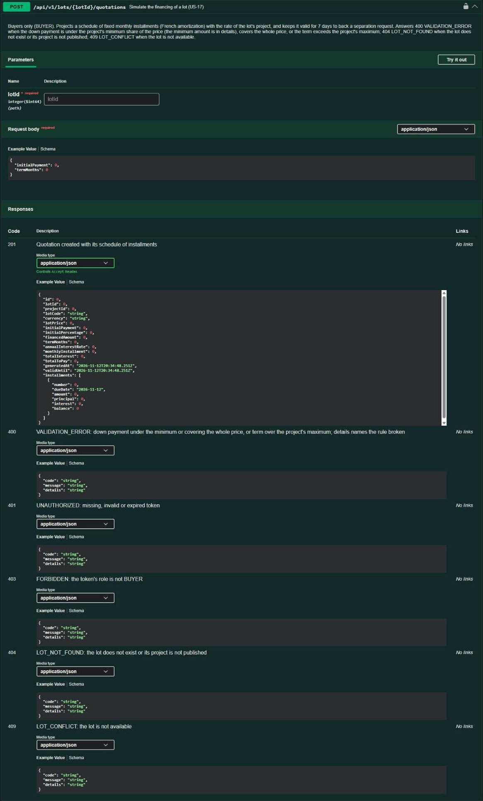
</p>

La [Tabla 4.29](#tabla-4-29) lista los commits relacionados con la documentación de los servicios.

<a id="tabla-4-29"></a>

**Tabla 4.29**

*Commits relacionados con la documentación de los Web Services en el Sprint 2*

| Repository | Commit Id | Documentation change |
|:---|:---|:---|
| [InmoNode-Backend](https://github.com/1ACC0238-2620-13981-NovaCorp-InmoNode/InmoNode-Backend) | [2586436](https://github.com/1ACC0238-2620-13981-NovaCorp-InmoNode/InmoNode-Backend/commit/2586436869d9bbe931b9e6f2e1885f3b8dbc88cd) | Anotaciones de AuthController y QuotationsController: acceso público de `/auth`, códigos de éxito, esquemas de respuesta, errores y etiquetas de historia. |
| [InmoNode-Backend](https://github.com/1ACC0238-2620-13981-NovaCorp-InmoNode/InmoNode-Backend) | [889ef84](https://github.com/1ACC0238-2620-13981-NovaCorp-InmoNode/InmoNode-Backend/commit/889ef84e1cdb3af5fff4311e4925736ae5fd64fc) | Pruebas que verifican el contrato OpenAPI de `/auth` y de cotizaciones. |
| [InmoNode-Backend](https://github.com/1ACC0238-2620-13981-NovaCorp-InmoNode/InmoNode-Backend) | [cd29852](https://github.com/1ACC0238-2620-13981-NovaCorp-InmoNode/InmoNode-Backend/commit/cd29852e274416a85c211e2cebde037bcd2d31b0) | Lecturas del catálogo: listado de proyectos público, y token opcional en el detalle y los lotes (`@OptionalAuthentication`). |
| [InmoNode-Backend](https://github.com/1ACC0238-2620-13981-NovaCorp-InmoNode/InmoNode-Backend) | [d152629](https://github.com/1ACC0238-2620-13981-NovaCorp-InmoNode/InmoNode-Backend/commit/d152629219b9d0a91fe08db5a798b44ad5fcfa64) | Prueba que verifica la seguridad de las lecturas del catálogo en el documento OpenAPI. |

##### 4.2.2.8. Software Deployment Evidence for Sprint Review

##### 4.2.2.9. Team Collaboration Insights during Sprint

### 4.3. Validation Interviews

#### 4.3.1. Diseño de Entrevistas

#### 4.3.2. Registro de Entrevistas

#### 4.3.3. Evaluaciones según heurísticas
